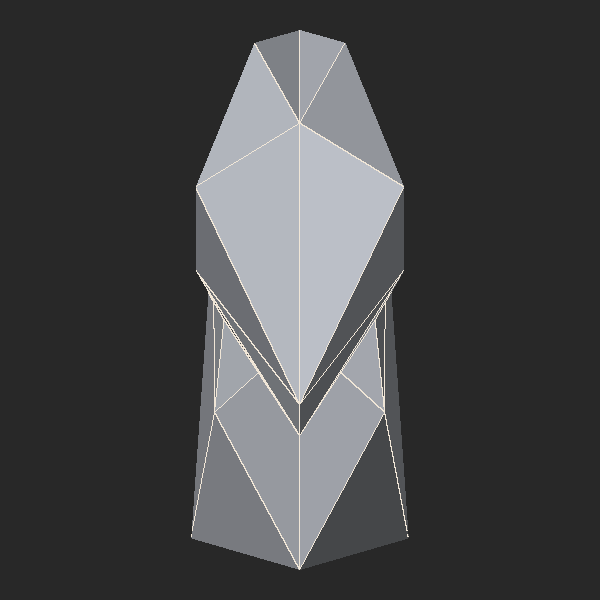
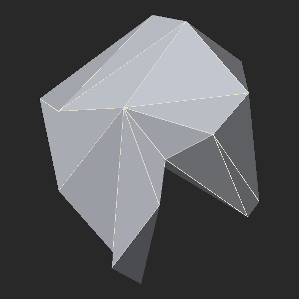
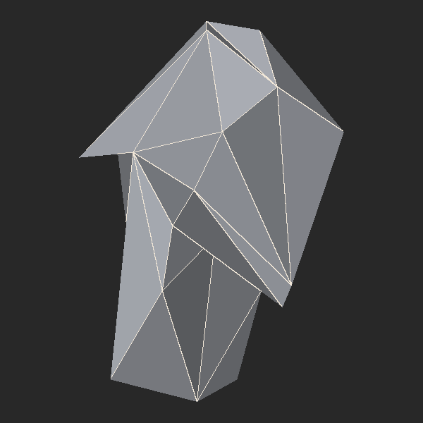
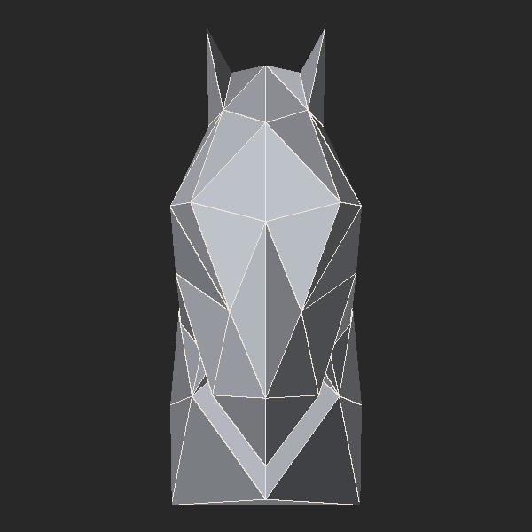
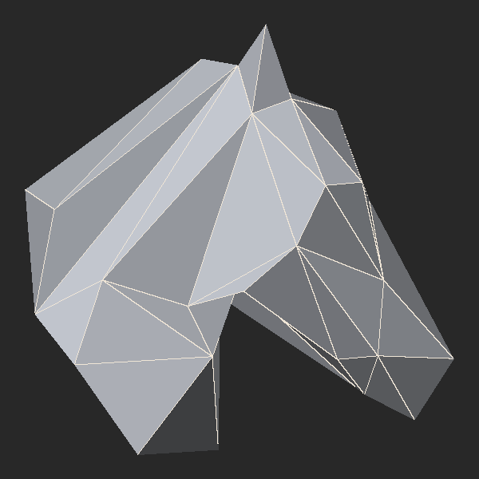
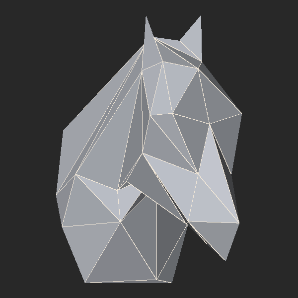
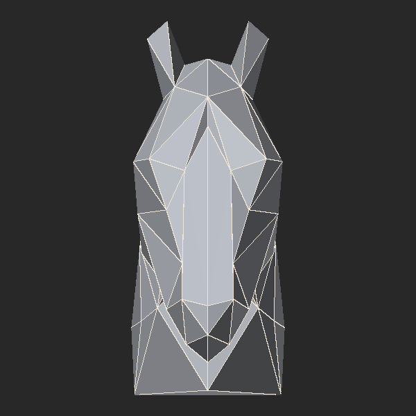
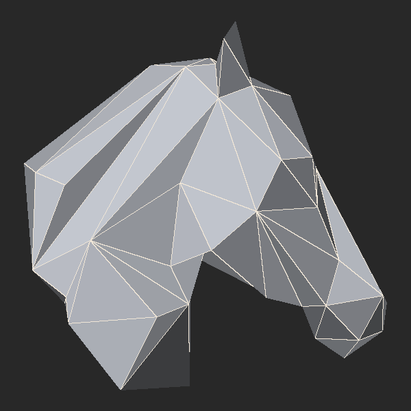
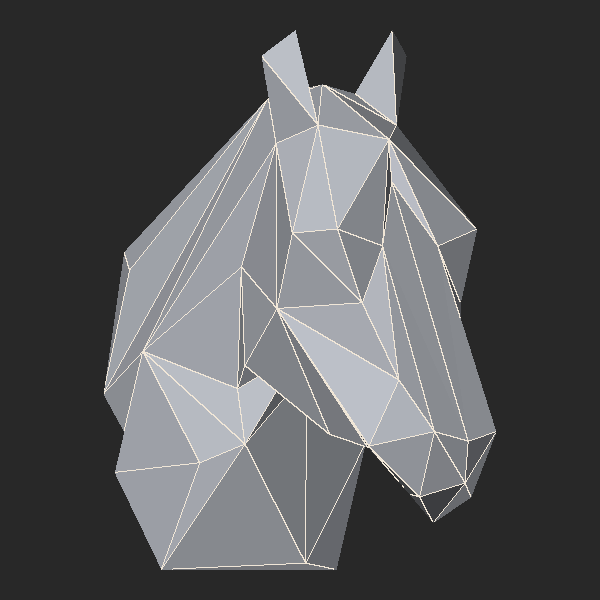

# Кони 50 / 100 / 150 — отчёт сборки

Собрано `node horse-r4t9p/tools/make-horse.js` (тикет #133) из `from-dev/art/tools/plates/src/horse/horse150.obj` (Meshy, 208 треугольников, замкнутая). Файл пересоздаётся при каждом запуске.

## Половина

Взята половина **+x** и отражена. Выбор по анфасу обеих половин, каждая отражена (сравнение до сборки): у +x уши прямые и острые, морда из крупных ровных граней; у −x уши круглые, морда раздроблена мелкими треугольниками. Высота 800 мм, Y вверх, морда на +Z, x = 0 — плоскость симметрии.

## Цифры

Как на сайте по умолчанию: сталь 2 мм, лазер, шов 0,5 мм, «Гнуть» и прорези включены. «Швы» — сварка без стыков, которые гнутся; «Проварка сгибов» — отдельно.

| | Конь (50) | Конь (100) | Конь (150) |
|---|---|---|---|
| Треугольников после упрощения | 48 (2 легли на шов — убраны) | 98 (2 легли на шов — убраны) | 150 |
| Граней до → после чистки | 48 → 44 | 95 → 93 | 147 → 145 |
| Деталей до → после чистки | 46 → 44 (−4,3 %) | 95 → 93 (−2,1 %) | 143 → 141 (−1,4 %) |
| Деталей → позиций на резку | 44 → 37 (заготовок со сгибами 7) | 93 → 59 (заготовок со сгибами 34) | 141 → 87 (заготовок со сгибами 54) |
| Масса, сталь 2 мм | 17,3 кг | 19,1 кг | 19,4 кг |
| Швы (сварка) | 16,5 м | 21,6 м | 26,0 м |
| Проварка сгибов | 1,8 м (7 сгибов) | 6,6 м (34 сгиба) | 8,6 м (54 сгиба) |
| Самая узкая деталь | 51 мм | 31 мм | 22 мм |
| Габарит Ш × В × Г | 322 × 800 × 653 мм | 320 × 800 × 796 мм | 328 × 800 × 785 мм |
| Неплоскость граней, макс. | 0,000 мм | 0,001 мм | 0,003 мм |
| Нарушенные правила | нет | нет | нет |
| Лишних швов (излом < 5°) | 4 | 13 | 18 |
| Сгиб без прорезей (предупреждение в «Итого», расчёт скрипта; страница может назвать ещё линию — см. комментарий #134) | нет | нет | Г24 V172 (1), Г26 V177 (1) — у линии есть обрывок короче 7 мм (перемычка + две ширины прорези) там, где она проходит через вырез заготовки; так по правилу 2 тикета #140 |

Проверка — по записанному `js/plates-horse*.js` (после округления до 0,01 мм). Правила и пороги — `tools/check.js`: плоскость ≤ 0,1 мм, рёбра ≥ 5 мм, ступеньки ≥ 8 мм, углы ≥ 5°, узкие ≥ 15 мм, самопересечений и протыканий 0, симметрия ≤ 0,1 мм, грани наружу, вырожденных 0, похожесть ≤ 2 мм от упрощённой модели до чистки, открытых рёбер 0.

## Конь (50)

- Морда: самая передняя точка (0, 245, 653), на высоте 245 из 800. Самая высокая точка (кончик уха или темя): (0, 800, 336).
- Нарушенные правила: нет.
- Чистка:
  - игла 3.2° у 160,286,50 — да
- Лишние швы (излом < 5°; не сливаем, отдельной задачей): №10.1–№13.1 (2,3°, гнётся), №10–№13 (2,3°, гнётся), №19.1–№15.1 (2,7°), №19–№15 (2,7°).

  

## Конь (100)

- Морда: самая передняя точка (0, 178, 796), на высоте 178 из 800. Самая высокая точка (кончик уха или темя): (100, 800, 448).
- Нарушенные правила: нет.
- Чистка:
  - узкая грань у 15,137,609 + соседняя (излом 7.7°) — да
- Лишние швы (излом < 5°; не сливаем, отдельной задачей): №29.1–№38.1 (0,6°, гнётся), №29–№38 (0,6°, гнётся), №19.1–№19 (0,7°, гнётся), №48.1–№44.1 (1,7°, гнётся), №48–№44 (1,7°, гнётся), №30.1–№23.1 (2,3°, гнётся), №30–№23 (2,3°, гнётся), №18.1–№26.1 (3,6°, гнётся), №18–№26 (3,6°, гнётся), №17.1–№15.1 (3,8°, гнётся), №17–№15 (3,8°, гнётся), №32.1–№40.1 (4,1°, гнётся), №32–№40 (4,1°, гнётся).

  

## Конь (150)

- Морда: самая передняя точка (0, 190, 785), на высоте 190 из 800. Самая высокая точка (кончик уха или темя): (87, 800, 458).
- Нарушенные правила: нет.
- Чистка:
  - узкая грань у 16,534,605 + соседняя (излом 1.8°) — да
- Лишние швы (излом < 5°; не сливаем, отдельной задачей): №19.1–№27.1 (1,2°), №19–№27 (1,2°), №23.1–№16.1 (1,5°, гнётся), №23–№16 (1,5°, гнётся), №45.1–№57.1 (1,9°, гнётся), №45–№57 (1,9°, гнётся), №41.1–№41 (2,0°), №33.1–№43.1 (2,3°), №33–№43 (2,3°), №20.1–№18.1 (2,8°, гнётся), №20–№18 (2,8°, гнётся), №69.1–№61.1 (3,0°, гнётся), №69–№61 (3,0°, гнётся), №44.1–№33.1 (3,3°, гнётся), №44–№33 (3,3°, гнётся), №65.1–№65 (3,3°, гнётся), №49.1–№59.1 (4,6°, гнётся), №49–№59 (4,6°, гнётся).

  

