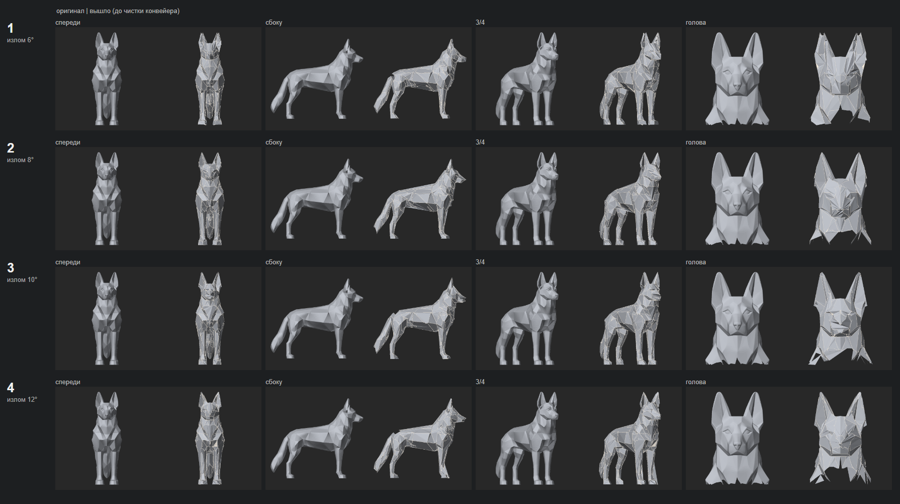

# Проба «плиты по изломам формы» (#144)

Ночь 23.11.2026. Вопрос Виталия: если нарезать Овчарку 5 не по нарисованным швам текстуры, а по изломам самой 3D-формы Meshy, будет ли ближе к оригиналу. Страница и её файлы не менялись: скрипты — в `from-dev/art/tools/plates/` (не в git), в git — только этот отчёт и картинки `img/probe-facets-*.png`.

**Решение — за Виталием.** Ниже цифры, картинки и моя рекомендация.

## Как сделано

`from-dev/art/tools/plates/facets.js` (новый): модель Meshy (158 тыс. треугольников) режется по x = 0, берётся правая половина.
1. Область растёт по соседним треугольникам, пока излом по ребру < порога **и** нормаль не ушла от средней нормали области больше порога (без второго условия плавная фаска из мелких изломов сливает всю собаку в 6 областей — проверено).
2. Области меньше 0,5 % площади головы (≈ 515 мм² в кадре 600) сливаются с соседом по самому слабому излому.
3. Граница — цепочки между «узлами» (где сходятся три области), каждая упрощается (допуск 1 мм в кадре 600) один раз, общая у соседей.
4. Плоскость области — по площади треугольников; узел ставится в пересечение плоскостей своих областей (МНК, не дальше 8 мм от исходной точки).
5. Область, плоская через x = 0, — одна плита; остальные — плита и её зеркало.

Выход — тот же формат, что у `plates.js` (`out/plates_f<N>.json`, кадр 600 мм), его читает `make-shepherd.js` (`plates:true`). `probe-run.js` делает копию `make-shepherd.js` с выходами в `out/probe/` (сам `make-shepherd.js` и страница не тронуты).

## Цифры

**Важно: чистка конвейера (`cleanFig`: выравнивание в плоскость, короткие рёбра, ступеньки, иглы, самопересечения) за ночь не закончилась** — на каждый порог она шла больше часа (на машине ещё шли чужие прогоны тестов) и была остановлена. Поэтому ниже цифры **«до чистки»**: плиты `facets.js` как есть, правила `tools/check.js` на кадре 1000 мм. Для сравнения у готовой Овчарки 5: 429 плит → 386 деталей, 0 самопересечений.

| Порог излома | Областей (правая половина): сразу → после слияния | Плит (обе половины) | Деталей (после склейки почти плоских) | Деталей на голове | Самопересечений | Протыканий | Узких (< 15 мм) | Неплоских | Коротких рёбер (< 5 мм) | Ступенек (< 8 мм без ребра) | Игл (< 5°) |
|---|---|---|---|---|---|---|---|---|---|---|---|
| 1 — 6° | 22 407 → 195 | 381 | 346 | 85 | 231 | 112 | 2 | 381 из 381 | 733 | 1586 | 185 |
| 2 — 8° | 15 681 → 182 | 352 | 323 | 82 | 179 | 102 | 1 | 352 из 352 | 771 | 1759 | 176 |
| 3 — 10° | 11 512 → 171 | 326 | 305 | 82 | 171 | 76 | 2 | 326 из 326 | 720 | 1481 | 162 |
| 4 — 12° | 8 729 → 157 | 298 | 277 | 72 | 163 | 66 | 0 | 294 из 298 | 810 | 1610 | 153 |

Симметрия 0 нарушений на всех порогах. У 12° ещё 298 «развёрнутых» граней и 18 открытых рёбер — ориентация плит не определилась. Масса, швы и раскрой не считались (нужна чистка). Что вышло из цифр:
- Деталей на голове 72–85 — рядом с целью Виталия «~90 в мастерской»; у текущей Овчарки 5 — 95 на голове, их Виталий доводит по кальке.
- Все плиты неплоские после того, как узел ставится в пересечение плоскостей соседей: у узла с четырьмя и более областями точка не может лежать во всех плоскостях. Это обычная работа `cleanFig`, но с таким числом нарушений (сотни коротких рёбер и ступенек, ~170–230 самопересечений) она слишком долгая.

## Картинки «оригинал | вышло» (до чистки)

Лист миниатюр с номерами: 

По порогам (слева оригинал — серый с освещением, справа плиты; границы плит светлые):

| № | Порог | Спереди | Сбоку | 3/4 | Голова спереди | Голова сбоку | Голова 3/4 |
|---|---|---|---|---|---|---|---|
| 1 | 6° | [img](img/probe-facets-f6-front.png) | [img](img/probe-facets-f6-side.png) | [img](img/probe-facets-f6-iso.png) | [img](img/probe-facets-f6-head-front.png) | [img](img/probe-facets-f6-head-side.png) | [img](img/probe-facets-f6-head-iso.png) |
| 2 | 8° | [img](img/probe-facets-f8-front.png) | [img](img/probe-facets-f8-side.png) | [img](img/probe-facets-f8-iso.png) | [img](img/probe-facets-f8-head-front.png) | [img](img/probe-facets-f8-head-side.png) | [img](img/probe-facets-f8-head-iso.png) |
| 3 | 10° | [img](img/probe-facets-f10-front.png) | [img](img/probe-facets-f10-side.png) | [img](img/probe-facets-f10-iso.png) | [img](img/probe-facets-f10-head-front.png) | [img](img/probe-facets-f10-head-side.png) | [img](img/probe-facets-f10-head-iso.png) |
| 4 | 12° | [img](img/probe-facets-f12-front.png) | [img](img/probe-facets-f12-side.png) | [img](img/probe-facets-f12-iso.png) | [img](img/probe-facets-f12-head-front.png) | [img](img/probe-facets-f12-head-side.png) | [img](img/probe-facets-f12-head-iso.png) |

Что видно глазами:
- Фигура целиком (спереди, сбоку, 3/4) узнаваема на всех порогах: поза, уши, хвост, лапы, крупные грани груди и плеча легли по изломам оригинала. На 8–10° грани крупнее и ближе к «настоящим» граням оригинала, на 6° больше мелочи, на 12° уже теряются грани морды и ушей.
- **Голова — слабое место.** Морда у всех порогов «рваная»: нос, глаза и скулы (мелкие изломы 3–10°) дают шипы и торчащие треугольники, потому что нескольких плоскостей в одном узле не хватает, чтобы ровно сойтись, а до чистки это ничем не сглажено. Лучше всех голова у 8° и 10°.
- Мордой «как у оригинала» так не получится без доработки: у оригинала морда — десятки мелких граней под 3–6°, а при пороге 8° и выше они сливаются.

## Рекомендация

1. **Порог 8°–10°** как основа (грани крупные и читаются, голова 82 детали). 6° — слишком много мелочи, 12° — теряет морду.
2. **Сама идея жизнеспособна**: тело и ноги нарезаются по реальным изломам модели без рисованных швов, плиты симметричны. Но **как есть к производству это не готово**: нужна чистка (все плиты неплоские, 160–230 самопересечений на фигуре).
3. Что делать дальше, если идти в эту сторону (отдельным тикетом):
   - ставить узлы не МНК по всем соседним плоскостям, а решать «сначала плоскость области, потом пересечение трёх основных», остальное — точки на ребре;
   - выровнять плоскости и упрощение цепочек до слияния (сейчас слияние идёт по сырым изломам);
   - ускорить `cleanFig` (проверка правил после каждой правки ~ O(n²) на 350 плит; ночью шло больше часа на порог).
4. **Мордой проще заняться в мастерской по кальке** (как сейчас): калька «форма оригинала» (тикет про рёбра сетки) покажет те самые изломы линиями, а разметка и «Нарезать» (тикеты 6–7) дадут довести голову руками. Тело можно взять из этой пробы после чистки.
5. Порог для кальки «форма оригинала» (4° по умолчанию из плана): проба показывает, что на 4° заливка дала бы больше областей, чем на 6° (22 тыс. против 195 после слияния) — для линий кальки это норма (линии покажут и мелкие изломы), решать по картинке кальки, а не этой пробы.

## Воспроизвести

```
node from-dev/art/tools/plates/facets.js from-dev/art/tools/plates/src/shepherd5/model/Meshy_AI_welded_adult_shepherd_final_20261122_image-to-3d-texture.obj ang=8
node from-dev/art/tools/plates/probe-raw.js        # цифры до чистки → out/probe/raw.json
node from-dev/art/tools/plates/probe-img.js        # картинки → shepherd-v6j3w/tools/img/probe-facets-*.png
node from-dev/art/tools/plates/probe-run.js 8      # плиты → чистка конвейера → out/probe/probe_f8/ (долго, больше часа)
```
