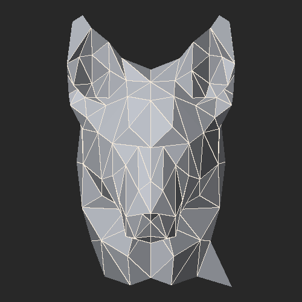
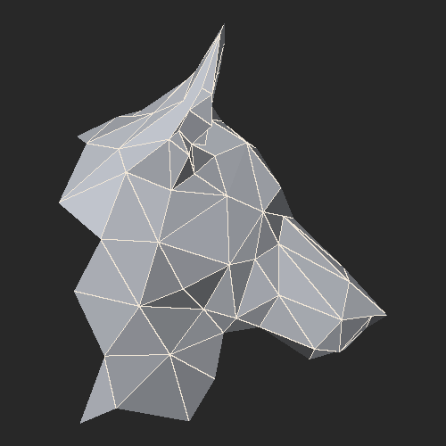
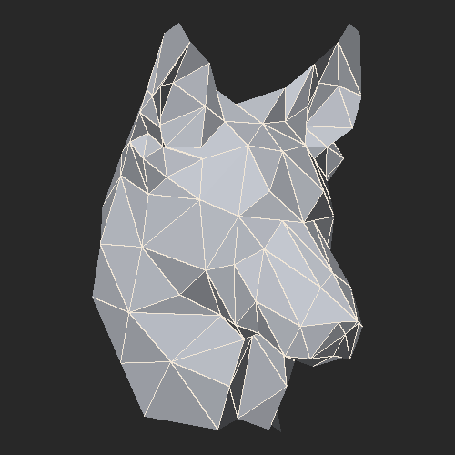
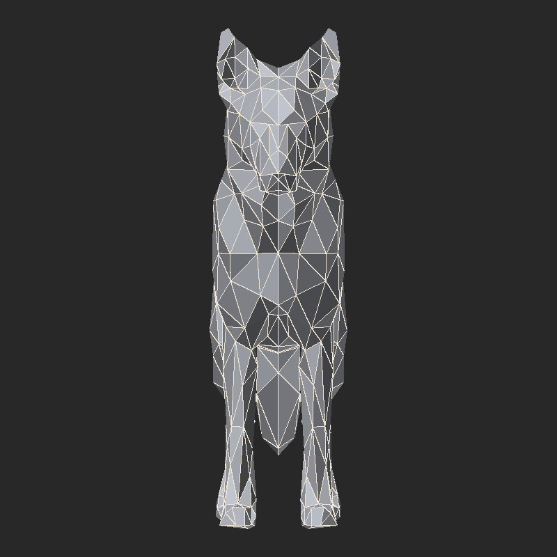
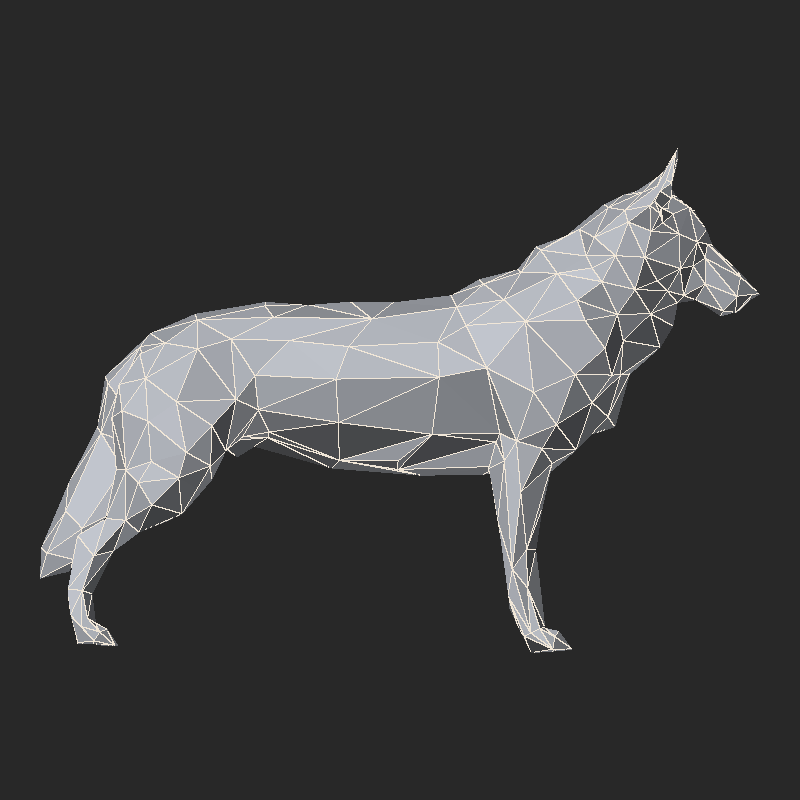
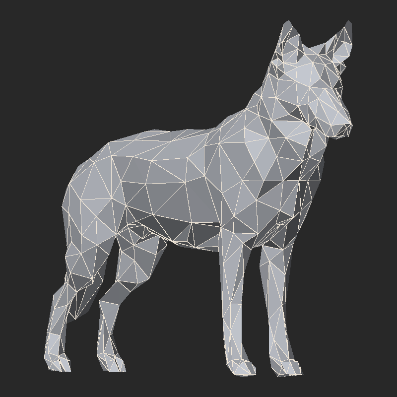

# Овчарка 2 (948) — отчёт сборки

Собрано `node shepherd-v6j3w/tools/make-shepherd.js shepherd2_1000` (тикет #142) из `from-dev/art/tools/plates/src/shepherd2/shepherd2_s1000.obj` — реалистичная модель Meshy (Perfectly_Aligned, 2628 треугольников), упрощённая скриптом до 1000 треугольников (QEM на правой половине + зеркало; `C:\Work\StartUp\проекты\овчарка-2\tools\simplify.py`), высота 1000 мм, морда на +Z, симметричная; 998 треугольников, замкнутая, без постамента. Упрощения нет. Файл пересоздаётся при каждом запуске.

## Цифры

Как на сайте по умолчанию: сталь 2 мм, лазер, шов 0,5 мм, «Гнуть» и прорези включены. «Швы» — сварка без стыков, которые гнутся; «Проварка сгибов» — отдельно.

| | Овчарка 2 (948) |
|---|---|
| Треугольников в эталоне | 998 |
| Граней после склейки почти плоских (0,5° / 0,3 мм) → после чистки | 976 → 948 |
| Деталей до → после чистки | 930 → 900 (−3,2 %) |
| Деталей → позиций на резку | 900 → 548 (заготовок со сгибами 340) |
| Масса, сталь 2 мм | 27,1 кг |
| Швы (сварка) | 69,8 м |
| Проварка сгибов | 25,4 м (352 сгиба) |
| Самая узкая деталь | 9 мм |
| Габарит Ш × В × Г | 275 × 1000 × 1422 мм |
| Неплоскость граней, макс. | 0,006 мм |
| Самопересечения / протыкания | 0 / 0 |
| Нарушенные правила после чистки | узкие грани (деталь уже 15 мм): 22, уход от эталона больше 2 мм: 4 |
| Лишних швов (излом < 5°) | 103 |
| Сгиб без прорезей (предупреждение в «Итого», расчёт скрипта) | Г40 V177 (1), Г40.1 V177 (1), Г159 V176 (1), Г159.1 V176 (1), Г169 V169 (1), Г169.1 V169 (1) |

Проверка — по записанному `js/plates-shepherd2_1000.js` (после округления до 0,01 мм). Правила и пороги — `tools/check.js`: плоскость ≤ 0,1 мм, рёбра ≥ 5 мм, ступеньки ≥ 8 мм, углы ≥ 5°, узкие ≥ 15 мм, самопересечений и протыканий 0, симметрия ≤ 0,1 мм, грани наружу, вырожденных 0, похожесть ≤ 2 мм от эталона после склейки, открытых рёбер 0.

## Голова

Нос как в эталоне, без «шапочки» (она подогнана под эталон старой Овчарки).

  

## Форма

- Морда: самая передняя точка (0, 709, 1422), на высоте 709 из 1000. Самая высокая точка (кончик уха): (-100, 1000, 1261).

## Чистка

Принято правок: 15, отклонено (откат или нельзя): 96. Правка, после которой появилось новое нарушение из жёстких (самопересечение, протыкание, уход от эталона, открытое ребро, развёрнутая или вырожденная грань, несимметрия), откатывается.

Принято:

- узкая грань у -119,949,1238 + соседняя (излом 15.0°) — да
- узкая грань у 116,81,87 + соседняя (излом 4.1°) — да
- узкая грань у 54,876,1259 + соседняя (излом 3.7°) — да
- узкая грань у -10,720,1405 + соседняя (излом 6.3°) — да
- узкая грань у 97,6,1017 + соседняя (излом 3.3°) — да
- узкая грань у 85,16,135 + соседняя (излом 27.6°) — да
- узкая грань у 17,816,1322 + соседняя (излом 13.1°) — да
- узкая грань у 62,7,1031 + соседняя (излом 6.7°) — да
- узкая грань у 69,875,1234 + соседняя (излом 9.4°) — да
- узкая грань у 41,929,1219 + соседняя (излом 15.3°) — да
- узкая грань у -120,906,1217 + соседняя (излом 1.3°) — да
- узкая грань у 101,991,1259 + соседняя (излом 10.5°) — да
- узкая грань у 111,15,1019 + соседняя (излом 8.2°) — да
- узкая грань у -120,929,1229 + соседняя (излом 5.9°) — да
- масштаб на высоту 1000 мм (×1.00044, только по высоте, сдвиг до 0.44 мм) — да

Осталось после чистки (не убирается без жёсткого нарушения):

- узкие грани (деталь уже 15 мм): 22 — [726,727,860,861,866,867,872,873,876,877,898,899,910,911,914,915,918,919,920,921,922,923]
- уход от эталона больше 2 мм: 4 — [436,437,482,483]

Лишние швы (излом < 5°; не сливаем, отдельной задачей): №173–№163 (1,1°), №173.1–№163.1 (1,1°), №345.1–№326.1 (1,7°, гнётся), №345–№326 (1,7°, гнётся), №184.1–№196.1 (1,8°, гнётся), №184–№196 (1,8°, гнётся), №402.1–№412.1 (1,9°, гнётся), №402–№412 (1,9°, гнётся), №109–№97 (2,0°, гнётся), №109.1–№97.1 (2,0°, гнётся), №314.1–№295.1 (2,0°, гнётся), №314–№295 (2,0°, гнётся), №340.1–№322.1 (2,1°, гнётся), №340–№322 (2,1°, гнётся), №243.1–№226.1 (2,1°, гнётся), №243–№226 (2,1°, гнётся), №141.1–№141 (2,3°, гнётся), №121.1–№108.1 (2,6°), №121–№108 (2,6°), №107.1–№95.1 (2,6°), №107–№95 (2,6°), №4.1–№1.1 (2,7°), №4–№1 (2,7°), №57–№46 (2,8°, гнётся), №57.1–№46.1 (2,8°, гнётся), №337.1–№320.1 (2,8°, гнётся), №337–№320 (2,8°, гнётся), №218.1–№217.1 (2,8°, гнётся), №218–№217 (2,8°, гнётся), №76.1–№69.1 (3,0°, гнётся), №76–№69 (3,0°, гнётся), №51.1–№61.1 (3,0°), №51–№61 (3,0°), №121.1–№136.1 (3,1°, гнётся), №121–№136 (3,1°, гнётся), №118.1–№104.1 (3,1°, гнётся), №118–№104 (3,1°, гнётся), №379.1–№377.1 (3,1°), №379–№377 (3,1°), №219.1–№202.1 (3,2°), №219–№202 (3,2°), №197–№211 (3,2°, гнётся), №197.1–№211.1 (3,2°, гнётся), №52.1–№63.1 (3,3°, гнётся), №52–№63 (3,3°, гнётся), №242.1–№259.1 (3,3°, гнётся), №242–№259 (3,3°, гнётся), №142.1–№156.1 (3,4°), №142–№156 (3,4°), №283–№263 (3,4°, гнётся), №283.1–№263.1 (3,4°, гнётся), №76.1–№85.1 (3,4°, гнётся), №76–№85 (3,4°, гнётся), №371.1–№353.1 (3,4°, гнётся), №371–№353 (3,4°, гнётся), №62–№51 (3,5°, гнётся), №62.1–№51.1 (3,5°, гнётся), №412.1–№419.1 (3,5°), №412–№419 (3,5°), №162.1–№172.1 (3,5°), №162–№172 (3,5°), №201.1–№191.1 (3,6°, гнётся), №201–№191 (3,6°, гнётся), №253.1–№269.1 (3,6°), №253–№269 (3,6°), №351–№368 (3,7°, гнётся), №351.1–№368.1 (3,7°, гнётся), №242.1–№225.1 (3,7°), №242–№225 (3,7°), №210–№195 (3,7°, гнётся), №210.1–№195.1 (3,7°, гнётся), №219.1–№219 (3,9°, гнётся), №42–№54 (3,9°, гнётся), №42.1–№54.1 (3,9°, гнётся), №395–№401 (4,0°, гнётся), №395.1–№401.1 (4,0°, гнётся), №120–№134 (4,0°, гнётся), №120.1–№134.1 (4,0°, гнётся), №334.1–№354.1 (4,1°, гнётся), №334–№354 (4,1°, гнётся), №13.1–№23.1 (4,2°, гнётся), №13–№23 (4,2°, гнётся), №164.1–№167.1 (4,2°, гнётся), №164–№167 (4,2°, гнётся), №8.1–№15.1 (4,2°, гнётся), №8–№15 (4,2°, гнётся), №450.1–№445.1 (4,2°), №450–№445 (4,2°), №162.1–№149.1 (4,3°, гнётся), №162–№149 (4,3°, гнётся), №146.1–№131.1 (4,4°, гнётся), №146–№131 (4,4°, гнётся), №188.1–№188 (4,4°), №252–№251 (4,8°, гнётся), №252.1–№251.1 (4,8°, гнётся), №129.1–№116.1 (4,9°, гнётся), №129–№116 (4,9°, гнётся), №216.1–№234.1 (4,9°), №216–№234 (4,9°), №184.1–№174.1 (4,9°), №184–№174 (4,9°), №81.1–№72.1 (5,0°, гнётся), №81–№72 (5,0°, гнётся).

Все попытки чистки

- узкая грань у 50,108,950 + соседняя (излом 21.7°) — откат: far
- узкая грань у 50,108,950 + соседняя (излом 25.3°) — откат: far
- узкая грань у 50,108,950 + соседняя (излом 95.6°) — откат: far
- узкая грань у -50,108,950 + соседняя (излом 21.7°) — откат: far
- узкая грань у -50,108,950 + соседняя (излом 25.3°) — откат: far
- узкая грань у -50,108,950 + соседняя (излом 95.6°) — откат: far
- узкая грань у -119,949,1238 + соседняя (излом 15.0°) — да
- узкая грань у 116,81,87 + соседняя (излом 4.1°) — да
- узкая грань у 120,951,1248 + соседняя (излом 6.4°) — откат: far
- узкая грань у 120,951,1248 + соседняя (излом 25.8°) — откат: far
- узкая грань у 120,951,1248 + соседняя (излом 81.6°) — откат: far
- узкая грань у -120,951,1248 + соседняя (излом 6.4°) — откат: far
- узкая грань у -120,951,1248 + соседняя (излом 25.8°) — откат: far
- узкая грань у -120,951,1248 + соседняя (излом 81.6°) — откат: far
- узкая грань у 47,44,988 + соседняя (излом 38.3°) — откат: far
- узкая грань у 47,44,988 + соседняя (излом 52.9°) — откат: far
- узкая грань у 47,44,988 + соседняя (излом 65.0°) — откат: far
- узкая грань у -47,44,988 + соседняя (излом 38.3°) — откат: far
- узкая грань у -47,44,988 + соседняя (излом 52.9°) — откат: far
- узкая грань у -47,44,988 + соседняя (излом 65.0°) — откат: far
- узкая грань у -92,977,1251 + соседняя (излом 39.9°) — откат: far
- узкая грань у -92,977,1251 + соседняя (излом 42.2°) — откат: far
- узкая грань у -92,977,1251 + соседняя (излом 145.0°) — нет: самопересечение
- узкая грань у 92,977,1251 + соседняя (излом 39.9°) — откат: far
- узкая грань у 92,977,1251 + соседняя (излом 42.2°) — откат: far
- узкая грань у 92,977,1251 + соседняя (излом 145.0°) — нет: самопересечение
- узкая грань у 111,26,980 + соседняя (излом 9.6°) — откат: far
- узкая грань у 111,26,980 + соседняя (излом 35.7°) — откат: far
- узкая грань у 111,26,980 + соседняя (излом 46.7°) — откат: far
- узкая грань у -111,26,980 + соседняя (излом 9.6°) — откат: far
- узкая грань у -111,26,980 + соседняя (излом 35.7°) — откат: far
- узкая грань у -111,26,980 + соседняя (излом 46.7°) — откат: far
- узкая грань у 54,876,1259 + соседняя (излом 3.7°) — да
- узкая грань у -10,720,1405 + соседняя (излом 6.3°) — да
- узкая грань у 97,6,1017 + соседняя (излом 3.3°) — да
- узкая грань у 47,44,988 + соседняя (излом 52.6°) — откат: far
- узкая грань у -47,44,988 + соседняя (излом 52.6°) — откат: far
- узкая грань у 111,27,980 + соседняя (излом 46.3°) — откат: far
- узкая грань у -111,27,980 + соседняя (излом 46.3°) — откат: far
- узкая грань у 85,16,135 + соседняя (излом 27.6°) — да
- узкая грань у 118,50,83 + соседняя (излом 57.8°) — откат: far
- узкая грань у 118,50,83 + соседняя (излом 78.0°) — откат: far
- узкая грань у 118,50,83 + соседняя (излом 92.7°) — откат: far
- узкая грань у -118,50,83 + соседняя (излом 57.8°) — откат: far
- узкая грань у -118,50,83 + соседняя (излом 78.0°) — откат: far
- узкая грань у -118,50,83 + соседняя (излом 92.7°) — откат: far
- узкая грань у 17,816,1322 + соседняя (излом 13.1°) — да
- узкая грань у 62,7,1031 + соседняя (излом 6.7°) — да
- узкая грань у 47,44,988 + соседняя (излом 55.2°) — откат: far
- узкая грань у -47,44,988 + соседняя (излом 55.2°) — откат: far
- узкая грань у 111,27,980 + соседняя (излом 46.8°) — откат: far
- узкая грань у -111,27,980 + соседняя (излом 46.8°) — откат: far
- узкая грань у 94,16,133 + соседняя (излом 15.2°) — откат: far
- узкая грань у 94,16,133 + соседняя (излом 18.5°) — откат: far
- узкая грань у 94,16,133 + соседняя (излом 112.1°) — откат: far
- узкая грань у -94,16,133 + соседняя (излом 15.2°) — откат: far
- узкая грань у -94,16,133 + соседняя (излом 18.5°) — откат: far
- узкая грань у -94,16,133 + соседняя (излом 112.1°) — откат: far
- узкая грань у -20,674,1369 + соседняя (излом 34.9°) — откат: far
- узкая грань у -20,674,1369 + соседняя (излом 57.6°) — откат: far
- узкая грань у -20,674,1369 + соседняя (излом 81.6°) — откат: far
- узкая грань у 20,674,1369 + соседняя (излом 34.9°) — откат: far
- узкая грань у 20,674,1369 + соседняя (излом 57.6°) — откат: far
- узкая грань у 20,674,1369 + соседняя (излом 81.6°) — откат: far
- узкая грань у 69,875,1234 + соседняя (излом 9.4°) — да
- узкая грань у 41,929,1219 + соседняя (излом 11.8°) — откат: far
- узкая грань у 41,929,1219 + соседняя (излом 15.3°) — да
- узкая грань у -92,977,1251 + соседняя (излом 41.5°) — откат: far
- узкая грань у 92,977,1251 + соседняя (излом 41.5°) — откат: far
- узкая грань у -120,906,1217 + соседняя (излом 1.3°) — да
- узкая грань у 120,951,1248 + соседняя (излом 25.9°) — откат: far
- узкая грань у -120,951,1248 + соседняя (излом 25.9°) — откат: far
- узкая грань у -50,26,1013 + соседняя (излом 76.2°) — откат: far
- узкая грань у -50,26,1013 + соседняя (излом 110.7°) — откат: far
- узкая грань у 50,26,1013 + соседняя (излом 76.2°) — откат: far
- узкая грань у 50,26,1013 + соседняя (излом 110.7°) — откат: far
- узкая грань у 101,991,1259 + соседняя (излом 10.5°) — да
- узкая грань у 120,951,1248 + соседняя (излом 6.2°) — откат: far
- узкая грань у 120,951,1248 + соседняя (излом 26.6°) — откат: far
- узкая грань у 120,951,1248 + соседняя (излом 80.5°) — откат: far
- узкая грань у -120,951,1248 + соседняя (излом 6.2°) — откат: far
- узкая грань у -120,951,1248 + соседняя (излом 26.6°) — откат: far
- узкая грань у -120,951,1248 + соседняя (излом 80.5°) — откат: far
- узкая грань у -92,977,1251 + соседняя (излом 46.5°) — откат: far
- узкая грань у -92,977,1251 + соседняя (излом 51.6°) — нет: узкая плита
- узкая грань у -92,977,1251 + соседняя (излом 134.1°) — нет: самопересечение
- узкая грань у 92,977,1251 + соседняя (излом 46.5°) — откат: far
- узкая грань у 92,977,1251 + соседняя (излом 51.6°) — нет: узкая плита
- узкая грань у 92,977,1251 + соседняя (излом 134.1°) — нет: самопересечение
- узкая грань у 111,15,1019 + соседняя (излом 8.2°) — да
- узкая грань у 111,27,981 + соседняя (излом 9.3°) — откат: far
- узкая грань у 111,27,981 + соседняя (излом 35.9°) — откат: far
- узкая грань у 111,27,981 + соседняя (излом 47.1°) — откат: far
- узкая грань у -111,27,981 + соседняя (излом 9.3°) — откат: far
- узкая грань у -111,27,981 + соседняя (излом 35.9°) — откат: far
- узкая грань у -111,27,981 + соседняя (излом 47.1°) — откат: far
- узкая грань у 123,925,1238 + соседняя (излом 24.0°) — откат: far
- узкая грань у 123,925,1238 + соседняя (излом 25.9°) — откат: far
- узкая грань у -123,925,1238 + соседняя (излом 24.0°) — откат: far
- узкая грань у -123,925,1238 + соседняя (излом 25.9°) — откат: far
- узкая грань у 4,705,1410 + соседняя (излом 25.1°) — откат: far
- узкая грань у 4,705,1410 + соседняя (излом 59.7°) — откат: far
- узкая грань у 4,705,1410 + соседняя (излом 63.3°) — откат: far
- узкая грань у -4,705,1410 + соседняя (излом 25.1°) — откат: far
- узкая грань у -4,705,1410 + соседняя (излом 63.3°) — откат: far
- узкая грань у -120,929,1229 + соседняя (излом 5.9°) — да
- узкая грань у 120,951,1248 + соседняя (излом 30.5°) — откат: far
- узкая грань у -120,951,1248 + соседняя (излом 30.5°) — откат: far
- узкая грань у 123,925,1238 + соседняя (излом 29.7°) — откат: far
- узкая грань у -123,925,1238 + соседняя (излом 29.7°) — откат: far
- масштаб на высоту 1000 мм (×1.00044, только по высоте, сдвиг до 0.44 мм) — да

## Картинки

  

