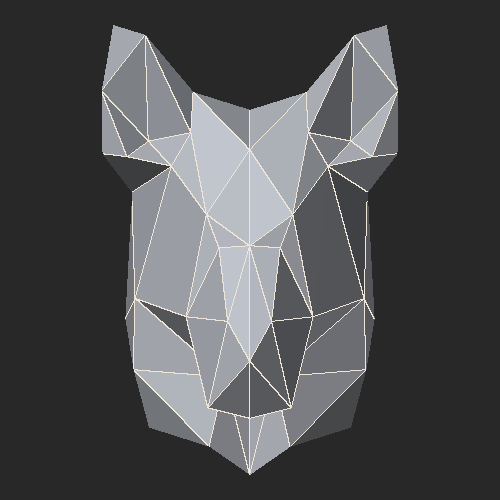
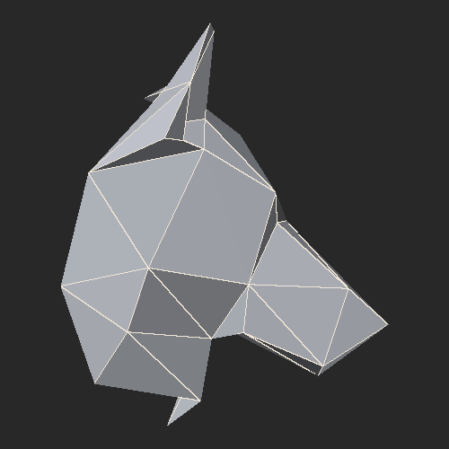
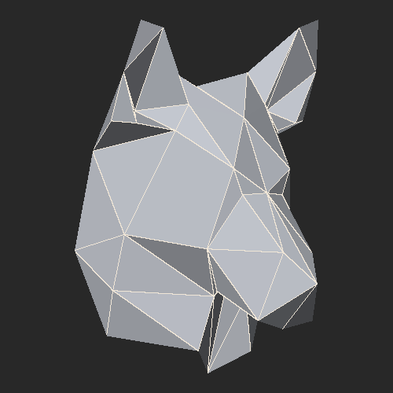
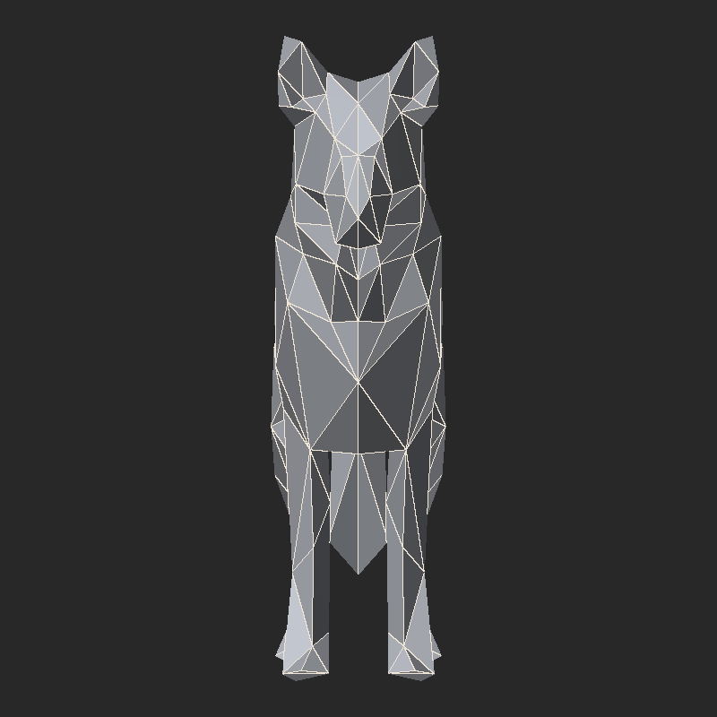
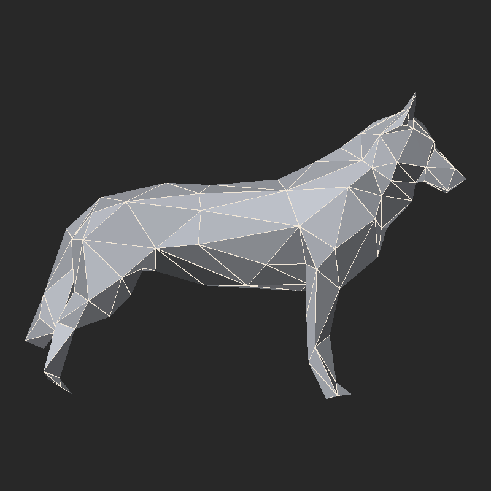
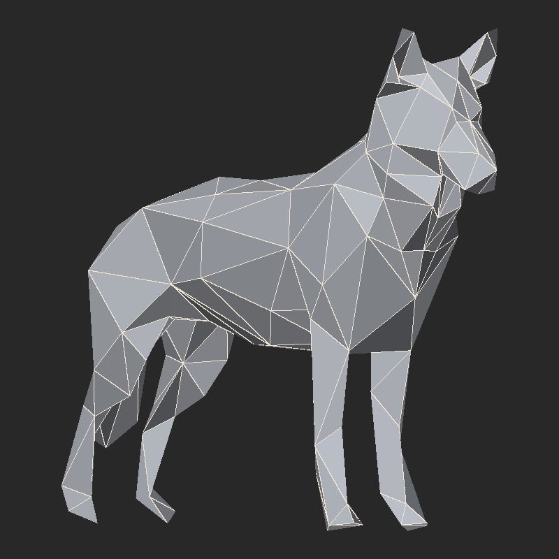

# Овчарка 2 (344) — отчёт сборки

Собрано `node shepherd-v6j3w/tools/make-shepherd.js shepherd2_350` (тикет #142) из `from-dev/art/tools/plates/src/shepherd2/shepherd2_s350.obj` — реалистичная модель Meshy (Perfectly_Aligned, 2628 треугольников), упрощённая скриптом до 350 треугольников (QEM на правой половине + зеркало; `C:\Work\StartUp\проекты\овчарка-2\tools\simplify.py`), высота 1000 мм, морда на +Z, симметричная; 350 треугольников, замкнутая, без постамента. Упрощения нет. Файл пересоздаётся при каждом запуске.

## Цифры

Как на сайте по умолчанию: сталь 2 мм, лазер, шов 0,5 мм, «Гнуть» и прорези включены. «Швы» — сварка без стыков, которые гнутся; «Проварка сгибов» — отдельно.

| | Овчарка 2 (344) |
|---|---|
| Треугольников в эталоне | 350 |
| Граней после склейки почти плоских (0,5° / 0,3 мм) → после чистки | 346 → 344 |
| Деталей до → после чистки | 336 → 330 (−1,8 %) |
| Деталей → позиций на резку | 330 → 200 (заготовок со сгибами 126) |
| Масса, сталь 2 мм | 26,9 кг |
| Швы (сварка) | 43,0 м |
| Проварка сгибов | 16,6 м (130 сгибов) |
| Самая узкая деталь | 17 мм |
| Габарит Ш × В × Г | 271 × 1000 × 1439 мм |
| Неплоскость граней, макс. | 0,003 мм |
| Самопересечения / протыкания | 0 / 0 |
| Нарушенные правила после чистки | нет |
| Лишних швов (излом < 5°) | 20 |
| Сгиб без прорезей (предупреждение в «Итого», расчёт скрипта) | Г44.1 V172 (1), Г47.1 m148 (1), Г51.1 V149 (1), Г53 V170 (1), Г64 V159 (1), Г64.1 V159 (1), Г65 V165 (1), Г65.1 V165 (1) |

Проверка — по записанному `js/plates-shepherd2_350.js` (после округления до 0,01 мм). Правила и пороги — `tools/check.js`: плоскость ≤ 0,1 мм, рёбра ≥ 5 мм, ступеньки ≥ 8 мм, углы ≥ 5°, узкие ≥ 15 мм, самопересечений и протыканий 0, симметрия ≤ 0,1 мм, грани наружу, вырожденных 0, похожесть ≤ 2 мм от эталона после склейки, открытых рёбер 0.

## Голова

Нос как в эталоне, без «шапочки» (она подогнана под эталон старой Овчарки).

  

## Форма

- Морда: самая передняя точка (0, 717, 1439), на высоте 717 из 1000. Самая высокая точка (кончик уха): (115, 1000, 1273).

## Чистка

Принято правок: 1, отклонено (откат или нельзя): 1. Правка, после которой появилось новое нарушение из жёстких (самопересечение, протыкание, уход от эталона, открытое ребро, развёрнутая или вырожденная грань, несимметрия), откатывается.

Принято:

- узкая грань у 98,886,1249 + соседняя (излом 69.7°) — да

Осталось после чистки (не убирается без жёсткого нарушения):

- ничего.

Лишние швы (излом < 5°; не сливаем, отдельной задачей): №104–№114 (1,7°, гнётся), №104.1–№114.1 (1,7°, гнётся), №90.1–№100.1 (2,0°, гнётся), №90–№100 (2,0°, гнётся), №122.1–№134.1 (2,0°), №122–№134 (2,0°), №30.1–№36.1 (2,4°, гнётся), №30–№36 (2,4°, гнётся), №68–№78 (2,6°, гнётся), №68.1–№78.1 (2,6°, гнётся), №58.1–№70.1 (2,9°), №58–№70 (2,9°), №82.1–№84.1 (3,2°, гнётся), №82–№84 (3,2°, гнётся), №18.1–№10.1 (3,3°, гнётся), №18–№10 (3,3°, гнётся), №108–№117 (3,6°, гнётся), №108.1–№117.1 (3,6°, гнётся), №67.1–№55.1 (4,6°, гнётся), №67–№55 (4,6°, гнётся).

Все попытки чистки

- узкая грань у 98,886,1249 + соседняя (излом 18.9°) — откат: far
- узкая грань у 98,886,1249 + соседняя (излом 69.7°) — да

## Картинки

  

