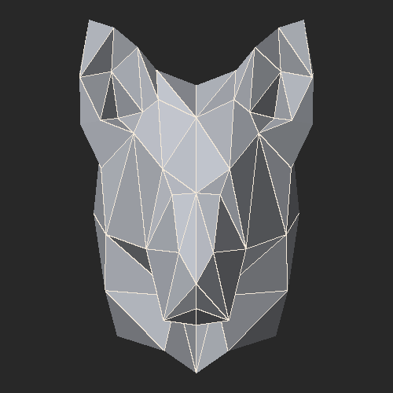
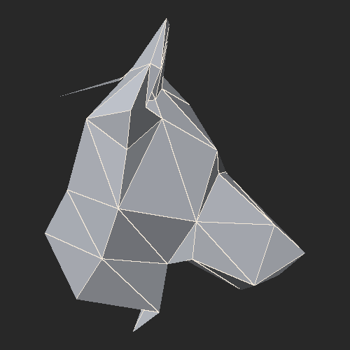
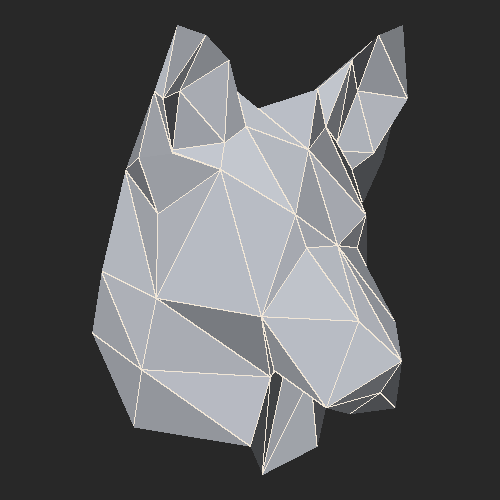
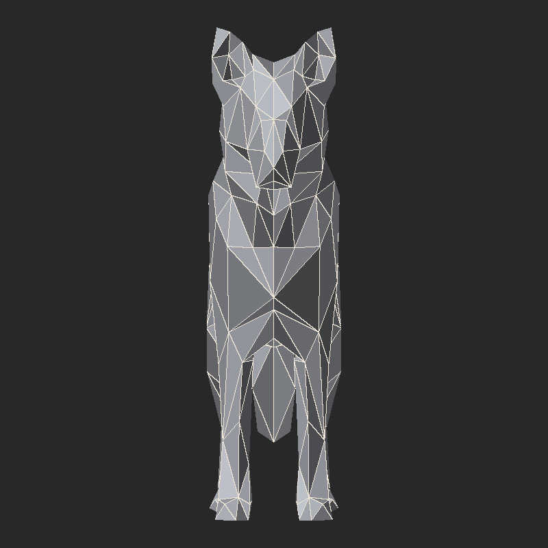
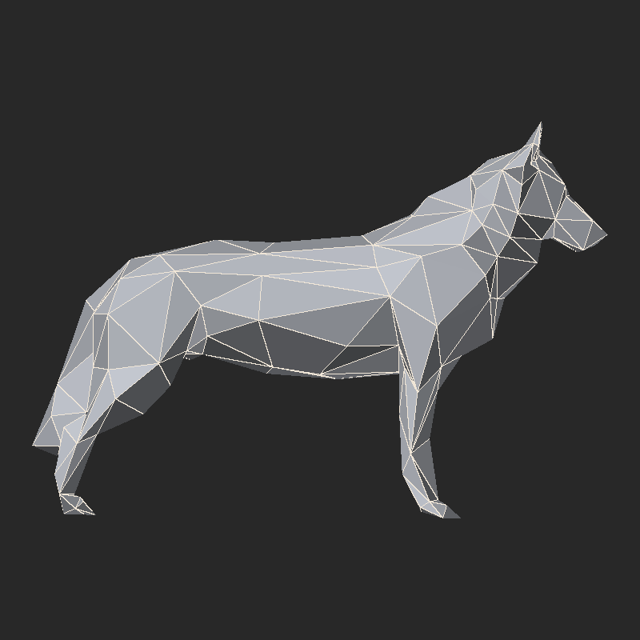
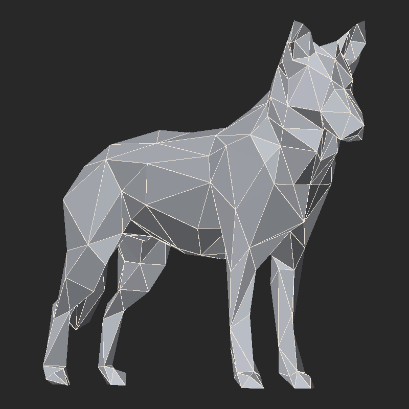

# Овчарка 2 (488) — отчёт сборки

Собрано `node shepherd-v6j3w/tools/make-shepherd.js shepherd2_500` (тикет #142) из `from-dev/art/tools/plates/src/shepherd2/shepherd2_s500.obj` — реалистичная модель Meshy (Perfectly_Aligned, 2628 треугольников), упрощённая скриптом до 500 треугольников (QEM на правой половине + зеркало; `C:\Work\StartUp\проекты\овчарка-2\tools\simplify.py`), высота 1000 мм, морда на +Z, симметричная; 500 треугольников, замкнутая, без постамента. Упрощения нет. Файл пересоздаётся при каждом запуске.

## Цифры

Как на сайте по умолчанию: сталь 2 мм, лазер, шов 0,5 мм, «Гнуть» и прорези включены. «Швы» — сварка без стыков, которые гнутся; «Проварка сгибов» — отдельно.

| | Овчарка 2 (488) |
|---|---|
| Треугольников в эталоне | 500 |
| Граней после склейки почти плоских (0,5° / 0,3 мм) → после чистки | 496 → 488 |
| Деталей до → после чистки | 482 → 472 (−2,1 %) |
| Деталей → позиций на резку | 472 → 289 (заготовок со сгибами 181) |
| Масса, сталь 2 мм | 27,8 кг |
| Швы (сварка) | 53,4 м |
| Проварка сгибов | 18,8 м (183 сгиба) |
| Самая узкая деталь | 13 мм |
| Габарит Ш × В × Г | 273 × 1000 × 1450 мм |
| Неплоскость граней, макс. | 0,004 мм |
| Самопересечения / протыкания | 0 / 0 |
| Нарушенные правила после чистки | узкие грани (деталь уже 15 мм): 6 |
| Лишних швов (излом < 5°) | 29 |
| Сгиб без прорезей (предупреждение в «Итого», расчёт скрипта) | Г5 m166 (1), Г91 V164 (1), Г91.1 V164 (1), Г96 m163 (1), Г96.1 m163 (1) |

Проверка — по записанному `js/plates-shepherd2_500.js` (после округления до 0,01 мм). Правила и пороги — `tools/check.js`: плоскость ≤ 0,1 мм, рёбра ≥ 5 мм, ступеньки ≥ 8 мм, углы ≥ 5°, узкие ≥ 15 мм, самопересечений и протыканий 0, симметрия ≤ 0,1 мм, грани наружу, вырожденных 0, похожесть ≤ 2 мм от эталона после склейки, открытых рёбер 0.

## Голова

Нос как в эталоне, без «шапочки» (она подогнана под эталон старой Овчарки).

  

## Форма

- Морда: самая передняя точка (0, 715, 1450), на высоте 715 из 1000. Самая высокая точка (кончик уха): (116, 1000, 1282).

## Чистка

Принято правок: 4, отклонено (откат или нельзя): 29. Правка, после которой появилось новое нарушение из жёстких (самопересечение, протыкание, уход от эталона, открытое ребро, развёрнутая или вырожденная грань, несимметрия), откатывается.

Принято:

- узкая грань у 99,885,1258 + соседняя (излом 23.2°) — да
- узкая грань у 52,953,1264 + соседняя (излом 6.4°) — да
- узкая грань у 42,938,1244 + соседняя (излом 6.6°) — да
- узкая грань у 55,897,1274 + соседняя (излом 9.4°) — да

Осталось после чистки (не убирается без жёсткого нарушения):

- узкие грани (деталь уже 15 мм): 6 — [424,425,476,477,480,481]

Лишние швы (излом < 5°; не сливаем, отдельной задачей): №33.1–№40.1 (1,7°, гнётся), №33–№40 (1,7°, гнётся), №121.1–№131.1 (2,1°, гнётся), №121–№131 (2,1°, гнётся), №17–№26 (2,7°, гнётся), №17.1–№26.1 (2,7°, гнётся), №91–№92 (2,7°, гнётся), №91.1–№92.1 (2,7°, гнётся), №170–№169 (2,7°, гнётся), №170.1–№169.1 (2,7°, гнётся), №223–№229 (2,8°, гнётся), №223.1–№229.1 (2,8°, гнётся), №116.1–№128.1 (3,6°, гнётся), №116–№128 (3,6°, гнётся), №117.1–№107.1 (3,7°, гнётся), №117–№107 (3,7°, гнётся), №94–№87 (3,9°, гнётся), №94.1–№87.1 (3,9°, гнётся), №78.1–№78 (4,1°, гнётся), №6.1–№12.1 (4,3°, гнётся), №6–№12 (4,3°, гнётся), №145.1–№163.1 (4,3°, гнётся), №145–№163 (4,3°, гнётся), №51.1–№60.1 (4,5°, гнётся), №51–№60 (4,5°, гнётся), №96.1–№89.1 (4,7°), №96–№89 (4,7°), №39.1–№46.1 (5,0°, гнётся), №39–№46 (5,0°, гнётся).

Все попытки чистки

- узкая грань у -101,378,944 + соседняя (излом 70.4°) — откат: far
- узкая грань у -101,378,944 + соседняя (излом 112.0°) — нет: самопересечение
- узкая грань у -101,378,944 + соседняя (излом 129.9°) — откат: far
- узкая грань у 101,378,944 + соседняя (излом 70.4°) — откат: far
- узкая грань у 101,378,944 + соседняя (излом 112.0°) — нет: самопересечение
- узкая грань у 101,378,944 + соседняя (излом 129.9°) — откат: far
- узкая грань у 122,960,1273 + соседняя (излом 35.0°) — откат: far
- узкая грань у 122,960,1273 + соседняя (излом 61.6°) — откат: far
- узкая грань у 122,960,1273 + соседняя (излом 75.0°) — откат: far
- узкая грань у -122,960,1273 + соседняя (излом 35.0°) — откат: far
- узкая грань у -122,960,1273 + соседняя (излом 61.6°) — откат: far
- узкая грань у -122,960,1273 + соседняя (излом 75.0°) — откат: far
- узкая грань у -118,924,1264 + соседняя (излом 65.5°) — откат: far
- узкая грань у -118,924,1264 + соседняя (излом 130.5°) — нет: самопересечение
- узкая грань у 118,924,1264 + соседняя (излом 65.5°) — откат: far
- узкая грань у 118,924,1264 + соседняя (излом 130.5°) — нет: самопересечение
- узкая грань у 99,885,1258 + соседняя (излом 18.0°) — откат: far
- узкая грань у 99,885,1258 + соседняя (излом 23.2°) — да
- узкая грань у 122,960,1273 + соседняя (излом 34.1°) — откат: far
- узкая грань у -122,960,1273 + соседняя (излом 34.1°) — откат: far
- узкая грань у -118,924,1265 + соседняя (излом 59.3°) — откат: far
- узкая грань у -118,924,1265 + соседняя (излом 130.7°) — нет: самопересечение
- узкая грань у 118,924,1265 + соседняя (излом 59.3°) — откат: far
- узкая грань у 118,924,1265 + соседняя (излом 130.7°) — нет: самопересечение
- узкая грань у 52,953,1264 + соседняя (излом 6.4°) — да
- узкая грань у 122,960,1273 + соседняя (излом 75.5°) — откат: far
- узкая грань у -122,960,1273 + соседняя (излом 75.5°) — откат: far
- узкая грань у 42,938,1244 + соседняя (излом 6.6°) — да
- узкая грань у 122,960,1273 + соседняя (излом 74.9°) — откат: far
- узкая грань у -122,960,1273 + соседняя (излом 74.9°) — откат: far
- узкая грань у 55,897,1274 + соседняя (излом 9.4°) — да
- узкая грань у -118,924,1265 + соседняя (излом 58.9°) — откат: far
- узкая грань у 118,924,1265 + соседняя (излом 58.9°) — откат: far

## Картинки

  

