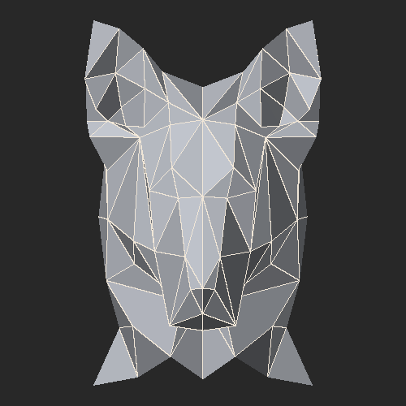
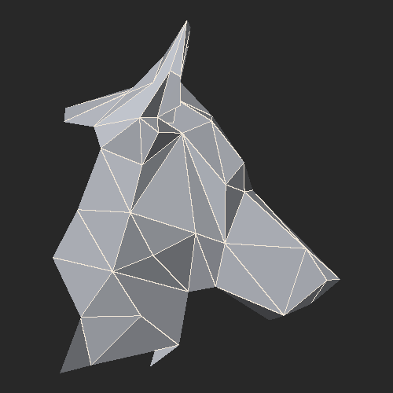
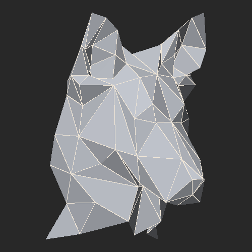
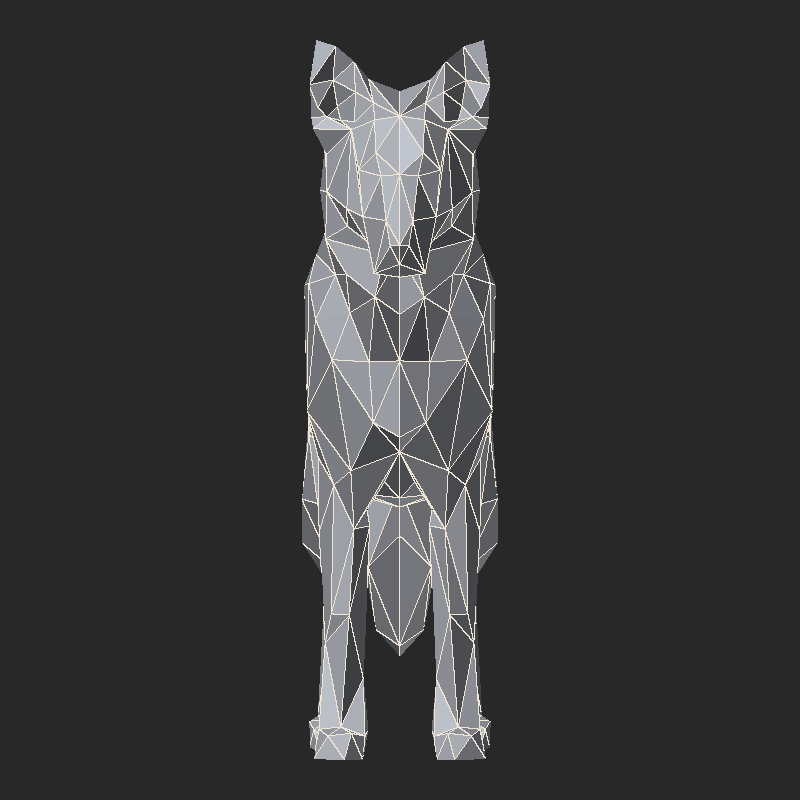
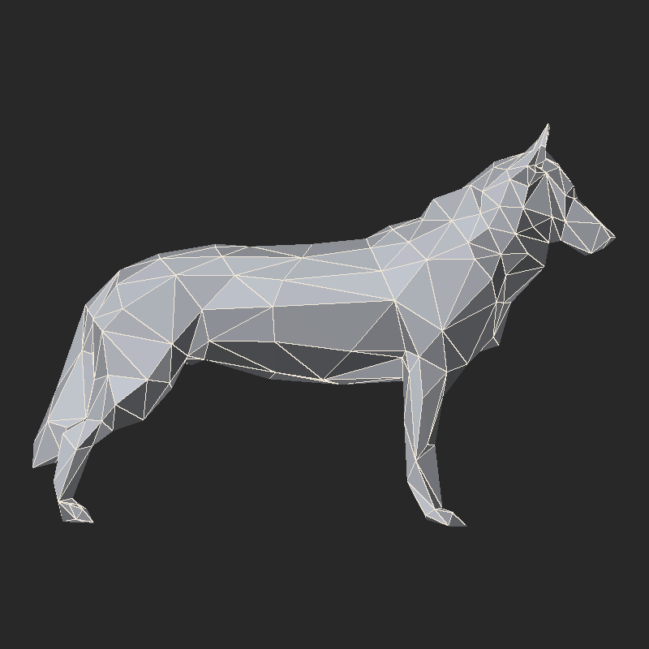
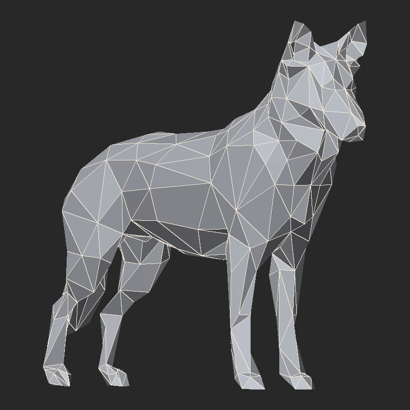

# Овчарка 2 (678) — отчёт сборки

Собрано `node shepherd-v6j3w/tools/make-shepherd.js shepherd2_700` (тикет #142) из `from-dev/art/tools/plates/src/shepherd2/shepherd2_s700.obj` — реалистичная модель Meshy (Perfectly_Aligned, 2628 треугольников), упрощённая скриптом до 700 треугольников (QEM на правой половине + зеркало; `C:\Work\StartUp\проекты\овчарка-2\tools\simplify.py`), высота 1000 мм, морда на +Z, симметричная; 700 треугольников, замкнутая, без постамента. Упрощения нет. Файл пересоздаётся при каждом запуске.

## Цифры

Как на сайте по умолчанию: сталь 2 мм, лазер, шов 0,5 мм, «Гнуть» и прорези включены. «Швы» — сварка без стыков, которые гнутся; «Проварка сгибов» — отдельно.

| | Овчарка 2 (678) |
|---|---|
| Треугольников в эталоне | 700 |
| Граней после склейки почти плоских (0,5° / 0,3 мм) → после чистки | 696 → 678 |
| Деталей до → после чистки | 674 → 654 (−3,0 %) |
| Деталей → позиций на резку | 654 → 392 (заготовок со сгибами 256) |
| Масса, сталь 2 мм | 27,9 кг |
| Швы (сварка) | 60,6 м |
| Проварка сгибов | 23,4 м (262 сгиба) |
| Самая узкая деталь | 12 мм |
| Габарит Ш × В × Г | 272 × 1000 × 1445 мм |
| Неплоскость граней, макс. | 0,004 мм |
| Самопересечения / протыкания | 0 / 0 |
| Нарушенные правила после чистки | узкие грани (деталь уже 15 мм): 6 |
| Лишних швов (излом < 5°) | 67 |
| Сгиб без прорезей (предупреждение в «Итого», расчёт скрипта) | Г1 m167 (1), Г1.1 m167 (1), Г61 V172 (2), Г61.1 V172 (2), Г72.1 V167 (1), Г106.1 V164 (1), Г114 V178 (1), Г114.1 V178 (1), Г118 V177 (1), Г118.1 V177 (1), Г127 m166 (1), Г127.1 m166 (1) |

Проверка — по записанному `js/plates-shepherd2_700.js` (после округления до 0,01 мм). Правила и пороги — `tools/check.js`: плоскость ≤ 0,1 мм, рёбра ≥ 5 мм, ступеньки ≥ 8 мм, углы ≥ 5°, узкие ≥ 15 мм, самопересечений и протыканий 0, симметрия ≤ 0,1 мм, грани наружу, вырожденных 0, похожесть ≤ 2 мм от эталона после склейки, открытых рёбер 0.

## Голова

Нос как в эталоне, без «шапочки» (она подогнана под эталон старой Овчарки).

  

## Форма

- Морда: самая передняя точка (0, 715, 1445), на высоте 715 из 1000. Самая высокая точка (кончик уха): (116, 1000, 1277).

## Чистка

Принято правок: 10, отклонено (откат или нельзя): 32. Правка, после которой появилось новое нарушение из жёстких (самопересечение, протыкание, уход от эталона, открытое ребро, развёрнутая или вырожденная грань, несимметрия), откатывается.

Принято:

- узкая грань у 121,958,1258 + соседняя (излом 4.9°) — да
- узкая грань у 101,902,1245 + соседняя (излом 17.0°) — да
- узкая грань у 55,884,1279 + соседняя (излом 3.7°) — да
- узкая грань у 88,9,144 + соседняя (излом 10.5°) — да
- узкая грань у 52,953,1259 + соседняя (излом 6.4°) — да
- узкая грань у 70,883,1254 + соседняя (излом 9.4°) — да
- узкая грань у -42,938,1239 + соседняя (излом 6.6°) — да
- узкая грань у 121,929,1266 + соседняя (излом 3.7°) — да
- узкая грань у 121,942,1250 + соседняя (излом 6.8°) — да
- масштаб на высоту 1000 мм (×0.99985, только по высоте, сдвиг до 0.15 мм) — да

Осталось после чистки (не убирается без жёсткого нарушения):

- узкие грани (деталь уже 15 мм): 6 — [600,601,654,655,656,657]

Лишние швы (излом < 5°; не сливаем, отдельной задачей): №150–№162 (1,3°, гнётся), №150.1–№162.1 (1,3°, гнётся), №149.1–№139.1 (1,4°, гнётся), №149–№139 (1,4°, гнётся), №148.1–№160.1 (1,6°), №148–№160 (1,6°), №88.1–№100.1 (1,6°, гнётся), №88–№100 (1,6°, гнётся), №8.1–№3.1 (1,6°), №8–№3 (1,6°), №248.1–№232.1 (1,9°, гнётся), №248–№232 (1,9°, гнётся), №102.1–№90.1 (2,0°, гнётся), №102–№90 (2,0°, гнётся), №130.1–№123.1 (2,0°, гнётся), №130–№123 (2,0°, гнётся), №126–№128 (2,2°, гнётся), №126.1–№128.1 (2,2°, гнётся), №281–№274 (2,4°, гнётся), №281.1–№274.1 (2,4°, гнётся), №280–№287 (2,6°, гнётся), №280.1–№287.1 (2,6°, гнётся), №104.1–№115.1 (2,7°, гнётся), №104–№115 (2,7°, гнётся), №109.1–№97.1 (2,8°, гнётся), №109–№97 (2,8°, гнётся), №8.1–№16.1 (2,9°, гнётся), №8–№16 (2,9°, гнётся), №69–№60 (3,0°, гнётся), №69.1–№60.1 (3,0°, гнётся), №180.1–№180 (3,2°, гнётся), №130–№138 (3,2°), №130.1–№138.1 (3,2°), №105.1–№117.1 (3,3°, гнётся), №105–№117 (3,3°, гнётся), №307.1–№301.1 (3,3°, гнётся), №307–№301 (3,3°, гнётся), №49–№57 (3,4°, гнётся), №49.1–№57.1 (3,4°, гнётся), №29.1–№38.1 (3,5°, гнётся), №29–№38 (3,5°, гнётся), №200.1–№184.1 (3,5°, гнётся), №200–№184 (3,5°, гнётся), №122.1–№129.1 (3,7°), №122–№129 (3,7°), №127–№119 (3,9°, гнётся), №127.1–№119.1 (3,9°, гнётся), №62.1–№71.1 (3,9°, гнётся), №62–№71 (3,9°, гнётся), №137.1–№129.1 (4,0°, гнётся), №137–№129 (4,0°, гнётся), №236.1–№251.1 (4,0°, гнётся), №236–№251 (4,0°, гнётся), №107.1–№107 (4,1°, гнётся), №22.1–№33.1 (4,1°, гнётся), №22–№33 (4,1°, гнётся), №9–№17 (4,4°, гнётся), №9.1–№17.1 (4,4°, гнётся), №174.1–№188.1 (4,5°, гнётся), №174–№188 (4,5°, гнётся), №323–№327 (4,5°), №323.1–№327.1 (4,5°), №254–№240 (4,9°, гнётся), №254.1–№240.1 (4,9°, гнётся), №75.1–№66.1 (4,9°, гнётся), №75–№66 (4,9°, гнётся), №106.1–№106 (5,0°, гнётся).

Все попытки чистки

- узкая грань у 23,433,208 + соседняя (излом 12.9°) — откат: far
- узкая грань у 23,433,208 + соседняя (излом 21.4°) — откат: far
- узкая грань у 23,433,208 + соседняя (излом 83.5°) — откат: far
- узкая грань у -23,433,208 + соседняя (излом 12.9°) — откат: far
- узкая грань у -23,433,208 + соседняя (излом 21.4°) — откат: far
- узкая грань у -23,433,208 + соседняя (излом 83.5°) — откат: far
- узкая грань у 121,958,1258 + соседняя (излом 4.9°) — да
- узкая грань у 122,960,1268 + соседняя (излом 29.2°) — откат: far
- узкая грань у 122,960,1268 + соседняя (излом 29.7°) — откат: far
- узкая грань у 122,960,1268 + соседняя (излом 79.0°) — откат: far
- узкая грань у -122,960,1268 + соседняя (излом 29.2°) — откат: far
- узкая грань у -122,960,1268 + соседняя (излом 29.7°) — откат: far
- узкая грань у -122,960,1268 + соседняя (излом 79.0°) — откат: far
- узкая грань у 101,902,1245 + соседняя (излом 17.0°) — да
- узкая грань у 122,960,1268 + соседняя (излом 31.6°) — откат: far
- узкая грань у -122,960,1268 + соседняя (излом 31.6°) — откат: far
- узкая грань у 55,884,1279 + соседняя (излом 3.7°) — да
- узкая грань у 11,726,1428 + соседняя (излом 21.7°) — откат: far
- узкая грань у 11,726,1428 + соседняя (излом 41.2°) — откат: far
- узкая грань у 11,726,1428 + соседняя (излом 56.4°) — откат: far
- узкая грань у -11,726,1428 + соседняя (излом 21.7°) — откат: far
- узкая грань у -11,726,1428 + соседняя (излом 41.2°) — откат: far
- узкая грань у -11,726,1428 + соседняя (излом 56.4°) — откат: far
- узкая грань у 88,9,144 + соседняя (излом 10.5°) — да
- узкая грань у 52,953,1259 + соседняя (излом 6.4°) — да
- узкая грань у 122,960,1268 + соседняя (излом 79.4°) — откат: far
- узкая грань у -122,960,1268 + соседняя (излом 79.4°) — откат: far
- узкая грань у 70,883,1254 + соседняя (излом 9.4°) — да
- узкая грань у -42,938,1239 + соседняя (излом 6.6°) — да
- узкая грань у 122,960,1268 + соседняя (излом 78.8°) — откат: far
- узкая грань у -122,960,1268 + соседняя (излом 78.8°) — откат: far
- узкая грань у 121,929,1266 + соседняя (излом 3.7°) — да
- узкая грань у 122,960,1268 + соседняя (излом 26.8°) — откат: far
- узкая грань у 122,960,1268 + соседняя (излом 33.0°) — откат: far
- узкая грань у 122,960,1268 + соседняя (излом 80.9°) — откат: far
- узкая грань у -122,960,1268 + соседняя (излом 26.8°) — откат: far
- узкая грань у -122,960,1268 + соседняя (излом 33.0°) — откат: far
- узкая грань у -122,960,1268 + соседняя (излом 80.9°) — откат: far
- узкая грань у 121,942,1250 + соседняя (излом 6.8°) — да
- узкая грань у 122,960,1268 + соседняя (излом 31.0°) — откат: far
- узкая грань у -122,960,1268 + соседняя (излом 31.0°) — откат: far
- масштаб на высоту 1000 мм (×0.99985, только по высоте, сдвиг до 0.15 мм) — да

## Картинки

  

