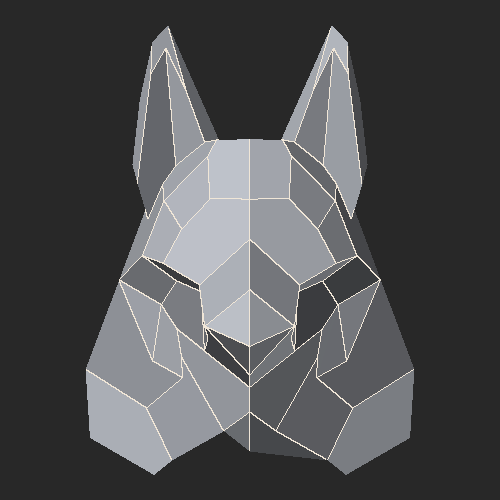
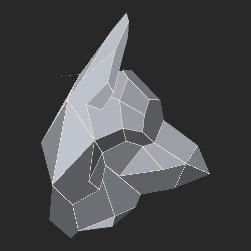
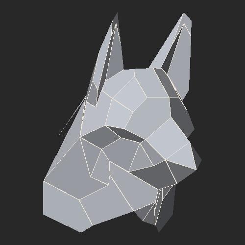
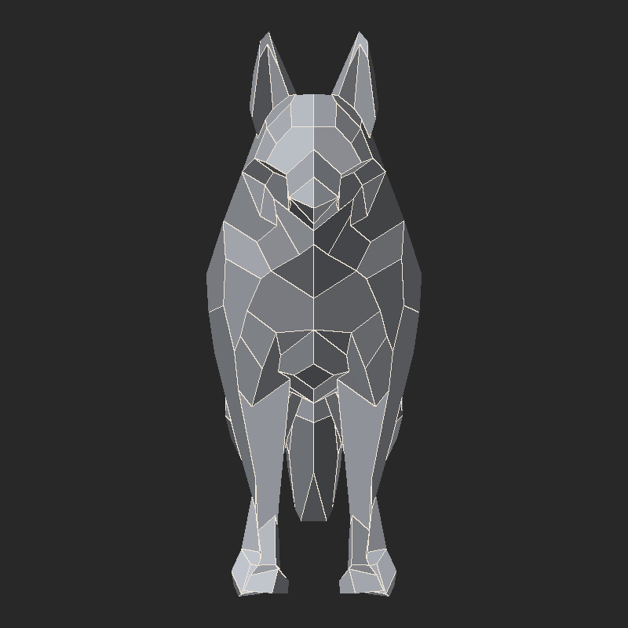
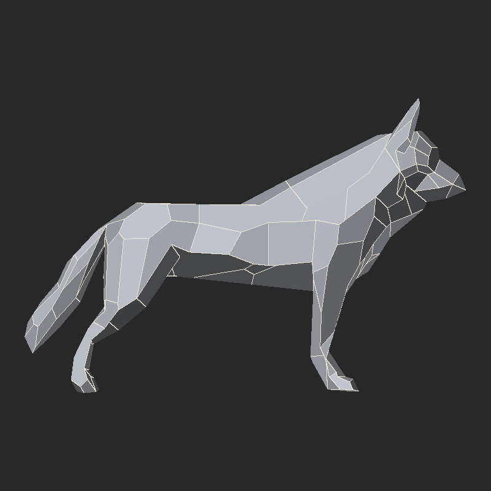
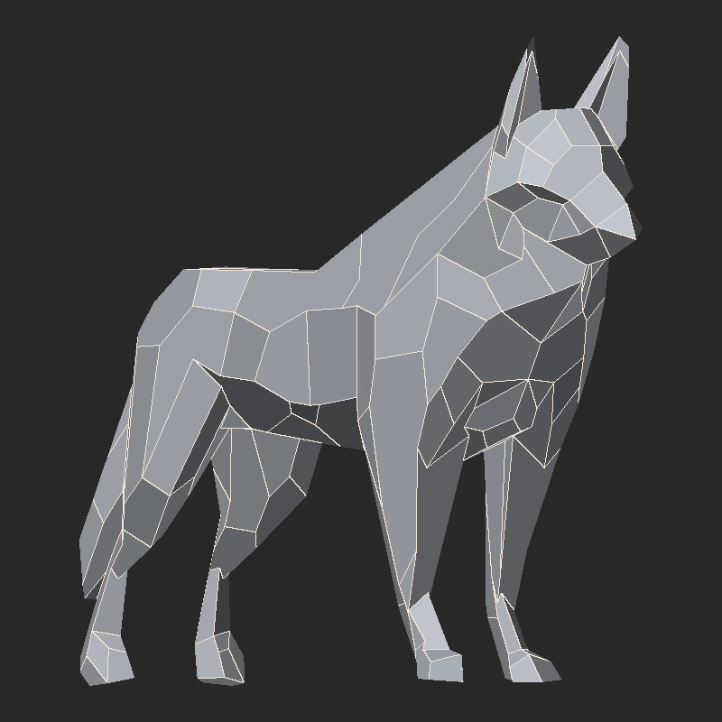

# Овчарка 3 — отчёт сборки

Собрано `node shepherd-v6j3w/tools/make-shepherd.js shepherd3` (тикет #142) из `from-dev/art/tools/plates/out/plates.json` — плиты конвейера `plates.js round=1 seed=2e-4 mina=1.5e-4 pen=1 ang=35 mm=25` по модели Meshy `Meshy_AI_shepherd_saber_tail_perfect_gap_3d_20261122` (316 тыс. треугольников) и текстуре швов `tex-h3.png` (5 видов тела и густой профиль головы, `project.js`), высота 1000 мм, морда на +Z, симметричная; 285 плит, замкнутая, без постамента. Упрощения нет. Файл пересоздаётся при каждом запуске.

## Цифры

Как на сайте по умолчанию: сталь 2 мм, лазер, шов 0,5 мм, «Гнуть» и прорези включены. «Швы» — сварка без стыков, которые гнутся; «Проварка сгибов» — отдельно.

| | Овчарка 3 |
|---|---|
| Плит конвейера (вход) | 285 |
| Граней на входе → после чистки | 285 → 283 |
| Деталей до → после чистки | 269 → 265 (−1,5 %) |
| Деталей → позиций на резку | 265 → 107 (заготовок со сгибами 78) |
| Деталей на голове (центр детали в области картинок головы: глубже 330 мм от кончика морды, выше 560 мм) | 68 |
| Масса, сталь 2 мм | 29,2 кг |
| Швы (сварка) | 36,5 м |
| Проварка сгибов | 13,6 м (158 сгибов) |
| Самая узкая деталь | 18 мм |
| Габарит Ш × В × Г | 381 × 1000 × 1497 мм |
| Неплоскость граней, макс. | 0,189 мм |
| Самопересечения / протыкания | 0 / 0 |
| Нарушенные правила после чистки | неплоские грани: 2, ступеньки (точки ближе 8 мм без ребра): 1, углы меньше 5°: 4 |
| Лишних швов (излом < 5°) | 27 |
| Сгиб без прорезей (предупреждение в «Итого», расчёт скрипта) | Г40.1 m140 (1) |

Проверка — по записанному `js/plates-shepherd3.js` (после округления до 0,01 мм). Правила и пороги — `tools/check.js`: плоскость ≤ 0,1 мм, рёбра ≥ 5 мм, ступеньки ≥ 8 мм, углы ≥ 5°, узкие ≥ 15 мм, самопересечений и протыканий 0, симметрия ≤ 0,1 мм, грани наружу, вырожденных 0, похожесть ≤ 2 мм от эталона после склейки, открытых рёбер 0.

## Голова

Швы головы — с густого профиля головы (`head-profile-dense-v3.png`, текстура `tex-h3.png`). Морду Виталий доводит до ~90 деталей в мастерской по кальке (`js/trace-shepherd3.js`, кадр — `xf.json`), потом `fromjson.js`.

  

## Форма

- Морда: самая передняя точка (0, 687, 1497), на высоте 687 из 1000. Самая высокая точка (кончик уха): (80, 1000, 1335).

## Чистка

Принято правок: 5, отклонено (откат или нельзя): 8. Правка, после которой появилось новое нарушение из жёстких (самопересечение, протыкание, уход от эталона, открытое ребро, развёрнутая или вырожденная грань, несимметрия), откатывается.

Принято:

- короткие рёбра — слито 1
- узкая грань у 46,920,1296 + соседняя (излом 7.8°) — да
- выравнивание в плоскость (2 граней, 1500 шагов) — да
- выравнивание в плоскость (2 граней, 4000 шагов) — да
- масштаб на высоту 1000 мм (×1.00043, только по высоте, сдвиг до 0.43 мм) — да

Осталось после чистки (не убирается без жёсткого нарушения):

- неплоские грани: 2 — [3,278]
- ступеньки (точки ближе 8 мм без ребра): 1 — [[23,29]]
- углы меньше 5°: 4 — [13,14,115,116]

Лишние швы (излом < 5°; не сливаем, отдельной задачей): №15–№22 (0,8°, гнётся), №29–№46 (0,9°, гнётся), №29–№16 (1,1°), №16.1–№22 (1,4°), №15–№16.1 (1,5°), №30–№21 (1,5°, гнётся), №21.1–№30.1 (1,5°, гнётся), №10–№14 (1,5°, гнётся), №47.1–№31.1 (1,6°, гнётся), №47–№31 (1,6°, гнётся), №31.1–№31 (1,6°), №84–№62 (2,1°, гнётся), №84.1–№62.1 (2,1°, гнётся), №56.1–№38.1 (2,4°, гнётся), №56–№38 (2,4°, гнётся), №117–№95.1 (2,7°), №117–№95 (2,7°), №95.1–№95 (2,8°, гнётся), №115–№94 (3,5°, гнётся), №115.1–№94.1 (3,5°, гнётся), №58.1–№59.1 (4,0°, гнётся), №58–№59 (4,0°, гнётся), №93.1–№69.1 (4,0°), №93–№69 (4,0°), №59.1–№60.1 (4,1°, гнётся), №59–№60 (4,1°, гнётся), №47.1–№47 (4,5°).

Все попытки чистки

- короткие рёбра — слито 1
- ступенька 6.5 мм у 3,398,391 — откат: far
- игла 1.7° у 71,703,1294 — откат: far
- игла 1.7° у -71,703,1294 — откат: far
- игла 4.9° у 29,884,1280 — откат: far
- игла 4.9° у -29,884,1280 — откат: far
- игла 4.5° у 67,166,1007 — откат: selfX
- игла 4.5° у -67,166,1007 — откат: selfX
- узкая грань у 46,920,1296 + соседняя (излом 7.8°) — да
- ступенька 6.5 мм у 3,397,391 — откат: far
- выравнивание в плоскость (2 граней, 1500 шагов) — да
- выравнивание в плоскость (2 граней, 4000 шагов) — да
- масштаб на высоту 1000 мм (×1.00043, только по высоте, сдвиг до 0.43 мм) — да

## Картинки

  

