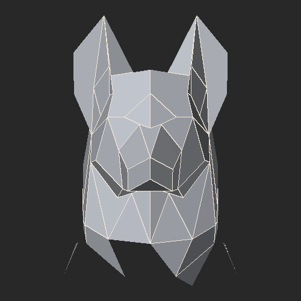
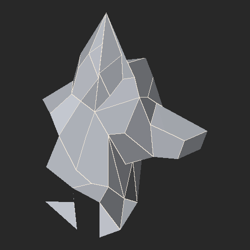
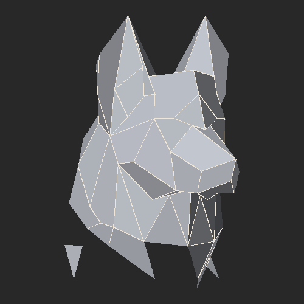
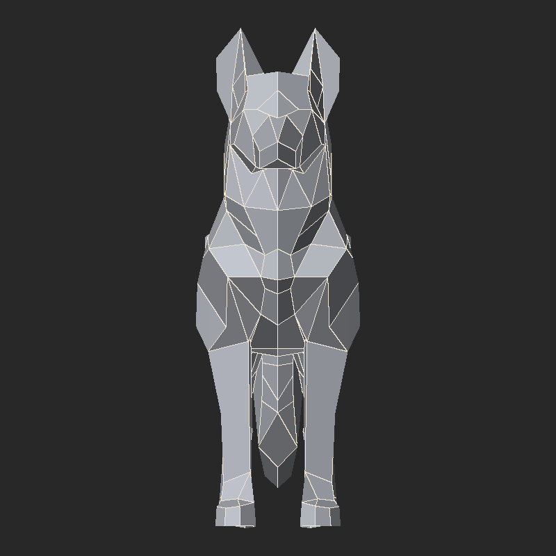
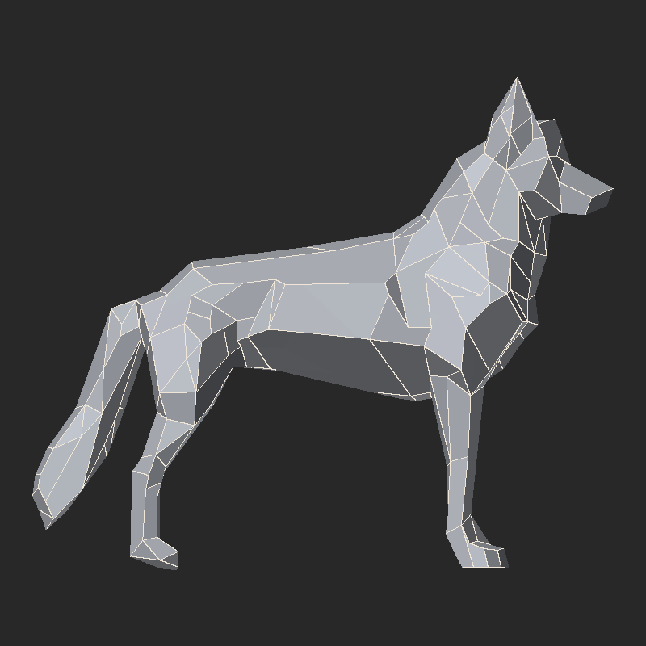
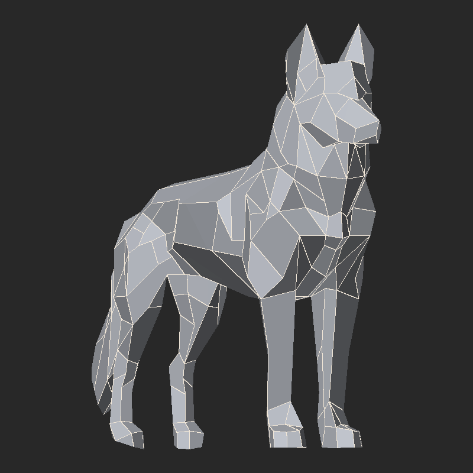

# Овчарка 5 — отчёт сборки

Собрано `node shepherd-v6j3w/tools/make-shepherd.js shepherd5` (тикет #142) из `from-dev/art/tools/plates/out/plates_s5b.json` — плиты конвейера `plates.js round=1 seed=2e-4 mina=1.5e-4 pen=1 ang=8 mm=6` по модели Meshy 7.1 `Meshy_AI_welded_adult_shepherd_final_20261122` (158 тыс. треугольников, гранёная, швы на текстуре), высота 1000 мм, морда на +Z, симметричная; 429 плит, замкнутая, без постамента. Упрощения нет. Файл пересоздаётся при каждом запуске.

## Цифры

Как на сайте по умолчанию: сталь 2 мм, лазер, шов 0,5 мм, «Гнуть» и прорези включены. «Швы» — сварка без стыков, которые гнутся; «Проварка сгибов» — отдельно.

| | Овчарка 5 |
|---|---|
| Плит конвейера (вход) | 429 |
| Граней на входе → после чистки | 429 → 429 |
| Деталей до → после чистки | 385 → 386 (−-0,3 %) |
| Деталей → позиций на резку | 386 → 157 (заготовок со сгибами 115) |
| Деталей на голове (центр детали в области картинок головы: глубже 330 мм от кончика морды, выше 560 мм) | 95 |
| Масса, сталь 2 мм | 23,2 кг |
| Швы (сварка) | 37,2 м |
| Проварка сгибов | 16,0 м (229 сгибов) |
| Самая узкая деталь | 22 мм |
| Габарит Ш × В × Г | 328 × 1000 × 1176 мм |
| Неплоскость граней, макс. | 0,007 мм |
| Самопересечения / протыкания | 0 / 0 |
| Нарушенные правила после чистки | углы меньше 5°: 4 |
| Лишних швов (излом < 5°) | 57 |
| Сгиб без прорезей (предупреждение в «Итого», расчёт скрипта) | Г42.1 m151 (1), Г58 V145 (1), Г58.1 V145 (1), Г59 m172 (4) |

Проверка — по записанному `js/plates-shepherd5.js` (после округления до 0,01 мм). Правила и пороги — `tools/check.js`: плоскость ≤ 0,1 мм, рёбра ≥ 5 мм, ступеньки ≥ 8 мм, углы ≥ 5°, узкие ≥ 15 мм, самопересечений и протыканий 0, симметрия ≤ 0,1 мм, грани наружу, вырожденных 0, похожесть ≤ 2 мм от эталона после склейки, открытых рёбер 0.

## Голова

Швы головы — с исходной текстуры модели Meshy (`src/shepherd5/model/*.png`). Морду Виталий доводит до ~90 деталей в мастерской по кальке (`js/trace-shepherd5.js`, кадр — `xf.json`), потом `fromjson.js`.

  

## Форма

- Морда: самая передняя точка (0, 772, 1176), на высоте 772 из 1000. Самая высокая точка (кончик уха): (74, 1000, 982).

## Чистка

Принято правок: 2, отклонено (откат или нельзя): 4. Правка, после которой появилось новое нарушение из жёстких (самопересечение, протыкание, уход от эталона, открытое ребро, развёрнутая или вырожденная грань, несимметрия), откатывается.

Принято:

- выравнивание в плоскость (6 граней, 1500 шагов) — да
- масштаб на высоту 1000 мм (×1.00002, только по высоте, сдвиг до 0.02 мм) — да

Осталось после чистки (не убирается без жёсткого нарушения):

- углы меньше 5°: 4 — [147,148,391,392]

Лишние швы (излом < 5°; не сливаем, отдельной задачей): №103.1–№105.1 (0,9°, гнётся), №103–№105 (0,9°, гнётся), №29–№28 (1,1°, гнётся), №81–№80 (1,4°, гнётся), №158.1–№139.1 (1,5°, гнётся), №158–№139 (1,5°, гнётся), №61.1–№47.1 (1,6°, гнётся), №61–№47 (1,6°, гнётся), №25.1–№38.1 (1,9°, гнётся), №25–№38 (1,9°, гнётся), №136.1–№136 (2,0°, гнётся), №170.1–№171.1 (2,3°, гнётся), №170–№171 (2,3°, гнётся), №184.1–№172.1 (2,4°, гнётся), №184–№172 (2,4°, гнётся), №17.1–№9.1 (2,4°, гнётся), №17–№9 (2,4°, гнётся), №74.1–№92.1 (2,5°, гнётся), №74–№92 (2,5°, гнётся), №162.1–№144.1 (2,6°, гнётся), №162–№144 (2,6°, гнётся), №31–№32 (2,6°, гнётся), №31.1–№32.1 (2,6°, гнётся), №83.1–№88.1 (2,7°, гнётся), №83–№88 (2,7°, гнётся), №164.1–№163.1 (2,7°, гнётся), №164–№163 (2,7°, гнётся), №113.1–№130.1 (2,7°), №113–№130 (2,7°), №19.1–№24.1 (3,2°, гнётся), №19–№24 (3,2°, гнётся), №158.1–№170.1 (3,3°, гнётся), №158–№170 (3,3°, гнётся), №100–№101 (3,4°, гнётся), №100.1–№101.1 (3,4°, гнётся), №86.1–№68.1 (3,4°, гнётся), №86–№68 (3,4°, гнётся), №84.1–№67.1 (3,4°, гнётся), №84–№67 (3,4°, гнётся), №89.1–№106.1 (3,4°, гнётся), №89–№106 (3,4°, гнётся), №26.1–№20.1 (3,6°, гнётся), №26–№20 (3,6°, гнётся), №41.1–№51.1 (3,7°), №41–№51 (3,7°), №142.1–№161.1 (4,0°, гнётся), №142–№161 (4,0°, гнётся), №119.1–№104.1 (4,6°, гнётся), №119–№104 (4,6°, гнётся), №193–№185 (4,6°, гнётся), №193.1–№185.1 (4,6°, гнётся), №147.1–№129.1 (4,7°, гнётся), №147–№129 (4,7°, гнётся), №8.1–№17.1 (4,8°), №8–№17 (4,8°), №128.1–№146.1 (4,9°, гнётся), №128–№146 (4,9°, гнётся).

Все попытки чистки

- игла 3.4° у 74,1000,982 — откат: far
- игла 3.4° у -74,1000,982 — откат: far
- игла 3.4° у 129,452,793 — откат: far
- игла 3.4° у -129,452,793 — откат: far
- выравнивание в плоскость (6 граней, 1500 шагов) — да
- масштаб на высоту 1000 мм (×1.00002, только по высоте, сдвиг до 0.02 мм) — да

## Картинки

  

