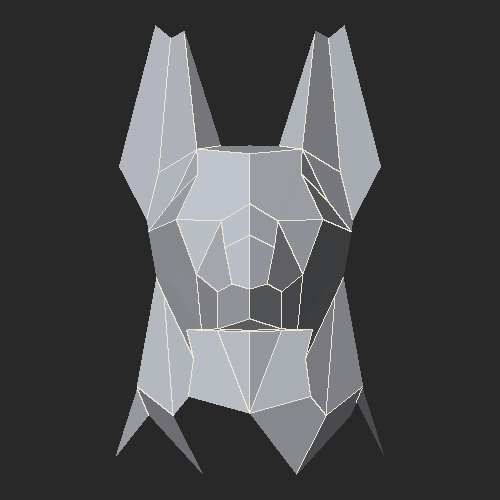
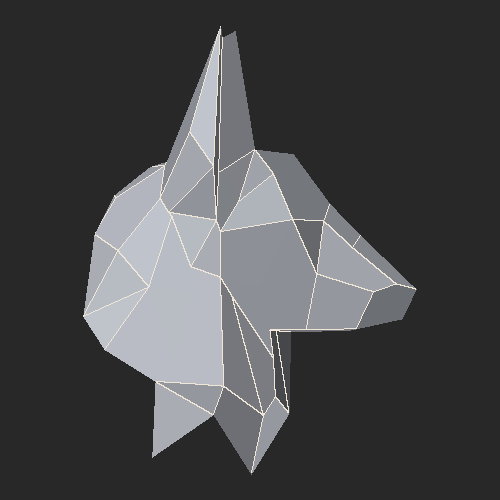
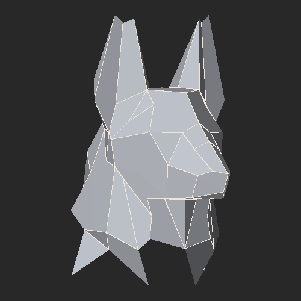
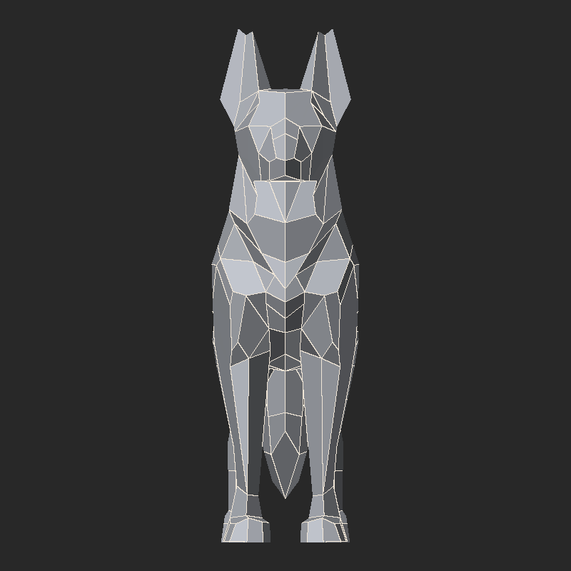
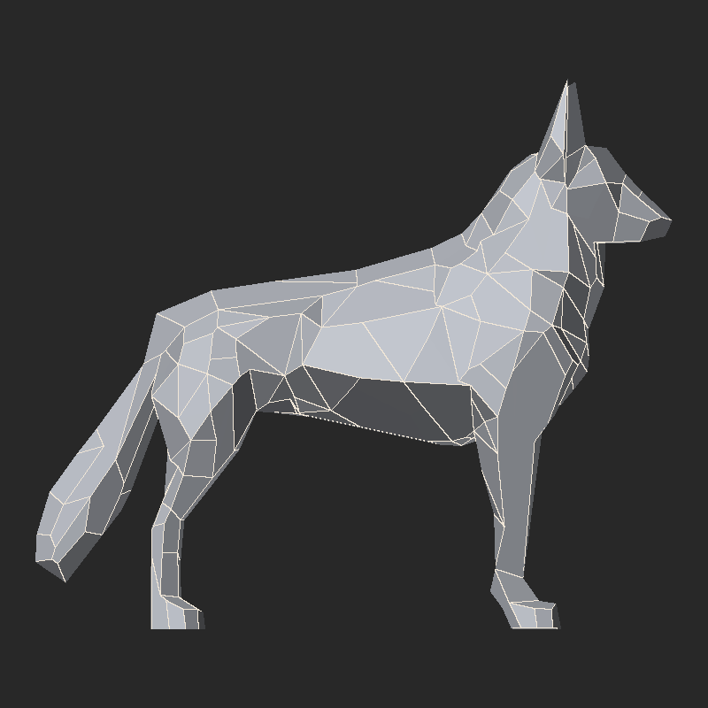
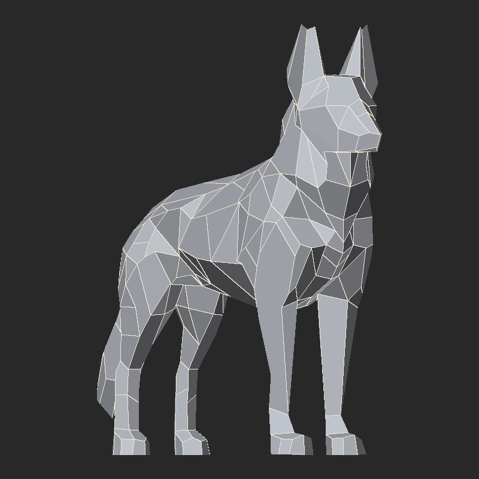

# Овчарка 6 (как доберман) — отчёт сборки

Собрано `node shepherd-v6j3w/tools/make-shepherd.js shepherd6` (тикет #171) из `from-dev/art/tools/plates/out/plates_s6.json` — плиты конвейера `plates.js round=1 ang=4 mm=3 seed=2e-4 mina=1.5e-4 tag=_s6` (`clean=13`) по модели Meshy 7.1 `Meshy_AI_welded_adult_shepherd_final_20261122` (158 336 треугольников, гранёная, швы на текстуре) + слияние швов с изломом < 1°, высота 1000 мм, морда на +Z, симметричная; 457 плит, замкнутая, без постамента. Упрощения нет. Файл пересоздаётся при каждом запуске.

## Цифры

Как на сайте по умолчанию: сталь 2 мм, лазер, шов 0,5 мм, «Гнуть» и прорези включены. «Швы» — сварка без стыков, которые гнутся; «Проварка сгибов» — отдельно.

| | Овчарка 6 (как доберман) |
|---|---|
| Плит конвейера (вход) | 457 |
| Граней на входе → после чистки | 457 → 451 |
| Деталей до → после чистки | 402 → 403 (−-0,2 %) |
| Деталей → позиций на резку | 403 → 154 (заготовок со сгибами 121) |
| Деталей на голове (центр детали в области картинок головы: глубже 330 мм от кончика морды, выше 560 мм) | 91 |
| Масса, сталь 2 мм | 22,4 кг |
| Швы (сварка) | 37,4 м |
| Проварка сгибов | 16,5 м (249 сгибов) |
| Самая узкая деталь | 26 мм |
| Габарит Ш × В × Г | 288 × 1000 × 1157 мм |
| Неплоскость граней, макс. | 0,008 мм |
| Самопересечения / протыкания | 0 / 0 |
| Нарушенные правила после чистки | рёбра короче 5 мм: 4, ступеньки (точки ближе 8 мм без ребра): 2 |
| Лишних швов (излом < 5°) | 58 |
| Сгиб без прорезей (предупреждение в «Итого», расчёт скрипта) | Г1 V159 (1), Г6.1 m153 (4), Г10.1 V173 (1), Г23 m148 (3), Г23.1 m148 (3), Г34 V165 (2), Г34.1 V165 (2) |

Проверка — по записанному `js/plates-shepherd6.js` (после округления до 0,01 мм). Правила и пороги — `tools/check.js`: плоскость ≤ 0,1 мм, рёбра ≥ 5 мм, ступеньки ≥ 8 мм, углы ≥ 5°, узкие ≥ 15 мм, самопересечений и протыканий 0, симметрия ≤ 0,1 мм, грани наружу, вырожденных 0, похожесть ≤ 2 мм от эталона после склейки, открытых рёбер 0.

## Голова

Швы — с исходной текстуры модели Meshy (`src/shepherd5/model/*.png`), без прорезей глаз.

  

## Форма

- Морда: самая передняя точка (0, 742, 1157), на высоте 742 из 1000. Самая высокая точка (кончик уха): (92, 1000, 966).

## Чистка

Чистки этого скрипта нет (грани не нарезаем, форму не правим): плиты конвейера как есть — перевод в кадр фигуры (1000 мм, низ y = 0, зад z = 0) и грани наружу. Обработка «как доберман»: конвейер (`plates.js … tag=_s6`, `clean=13`) свёл в точку короткие рёбра < 13 мм — схлопнуто 30, пропущено 25 (самопересечение 19, узкая плита 4, один конец на середине 2); затем этот скрипт слил швы с изломом < 1° (`clean.js` mergeSeam, зеркальная пара — вместе; правка с новым жёстким нарушением откатывается) — список ниже. Остальные лишние швы не трогали.

Принято правок: 3, отклонено (откат или нельзя): 0. Правка, после которой появилось новое нарушение из жёстких (самопересечение, протыкание, уход от эталона, открытое ребро, развёрнутая или вырожденная грань, несимметрия), откатывается.

Принято:

- шов с изломом 0.77° у -117,299,857 — слит (с зеркальным), сдвиг точек до 1.66 мм — да
- шов с изломом 0.76° у -112,316,879 — слит (с зеркальным), сдвиг точек до 3.44 мм — да
- шов с изломом 0.78° у -27,363,147 — слит (с зеркальным), сдвиг точек до 2.77 мм — да

Осталось после чистки (не убирается без жёсткого нарушения):

- рёбра короче 5 мм: 4 — [[175,444],[176,445],[558,571],[559,572]]
- ступеньки (точки ближе 8 мм без ребра): 2 — [[34,245],[41,248]]

Лишние швы (излом < 5°; не сливаем, отдельной задачей): №156.1–№130.1 (1,6°), №156–№130 (1,6°), №189.1–№192.1 (1,6°, гнётся), №189–№192 (1,6°, гнётся), №74.1–№89.1 (1,7°, гнётся), №74–№89 (1,7°, гнётся), №27–№41 (1,7°, гнётся), №27.1–№41.1 (1,7°, гнётся), №59.1–№57.1 (1,7°, гнётся), №59–№57 (1,7°, гнётся), №76.1–№75.1 (1,8°, гнётся), №76–№75 (1,8°, гнётся), №112.1–№90.1 (1,8°, гнётся), №112–№90 (1,8°, гнётся), №94.1–№114.1 (1,8°, гнётся), №94–№114 (1,8°, гнётся), №153.1–№170.1 (1,8°, гнётся), №153–№170 (1,8°, гнётся), №101.1–№122.1 (2,0°, гнётся), №101–№122 (2,0°, гнётся), №179.1–№166.1 (2,1°, гнётся), №179–№166 (2,1°, гнётся), №157.1–№156.1 (2,1°), №157–№156 (2,1°), №157.1–№130.1 (2,1°, гнётся), №157–№130 (2,1°, гнётся), №47.1–№54.1 (2,2°, гнётся), №47–№54 (2,2°, гнётся), №109.1–№109 (2,5°, гнётся), №83.1–№81.1 (2,8°, гнётся), №83–№81 (2,8°, гнётся), №33.1–№31.1 (2,8°), №33–№31 (2,8°), №72.1–№71.1 (2,9°, гнётся), №72–№71 (2,9°, гнётся), №108.1–№88.1 (3,1°, гнётся), №108–№88 (3,1°, гнётся), №104.1–№102.1 (3,3°, гнётся), №104–№102 (3,3°, гнётся), №166.1–№165.1 (3,3°, гнётся), №166–№165 (3,3°, гнётся), №138.1–№115.1 (3,7°, гнётся), №138–№115 (3,7°, гнётся), №48–№56 (3,8°, гнётся), №48.1–№56.1 (3,8°, гнётся), №59.1–№69.1 (3,8°, гнётся), №59–№69 (3,8°, гнётся), №58.1–№60.1 (4,0°, гнётся), №58–№60 (4,0°, гнётся), №194.1–№187.1 (4,3°, гнётся), №194–№187 (4,3°, гнётся), №24.1–№35.1 (4,4°, гнётся), №24–№35 (4,4°, гнётся), №30.1–№30 (4,7°, гнётся), №134.1–№107.1 (4,8°), №134–№107 (4,8°), №79.1–№66.1 (4,9°, гнётся), №79–№66 (4,9°, гнётся).

Все попытки чистки

- шов с изломом 0.77° у -117,299,857 — слит (с зеркальным), сдвиг точек до 1.66 мм — да
- шов с изломом 0.76° у -112,316,879 — слит (с зеркальным), сдвиг точек до 3.44 мм — да
- шов с изломом 0.78° у -27,363,147 — слит (с зеркальным), сдвиг точек до 2.77 мм — да

## Картинки

  

