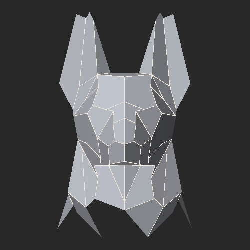
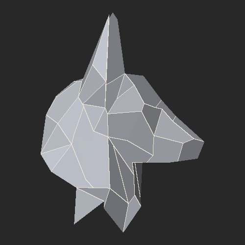
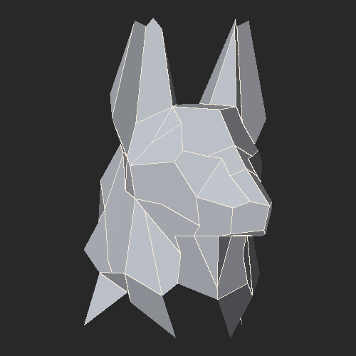
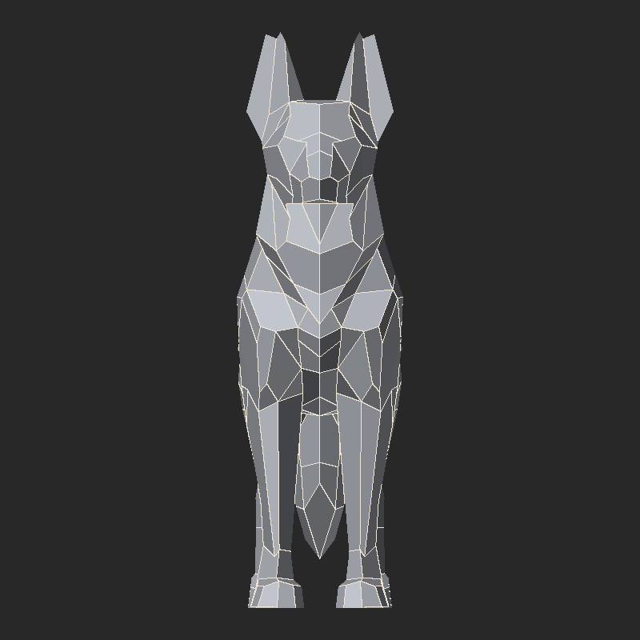
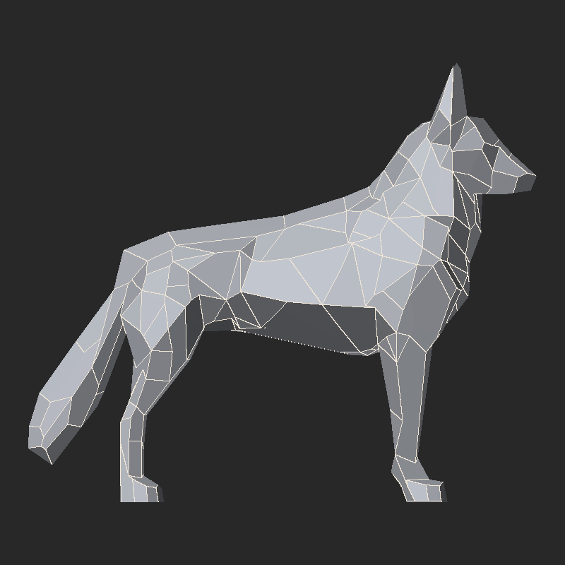
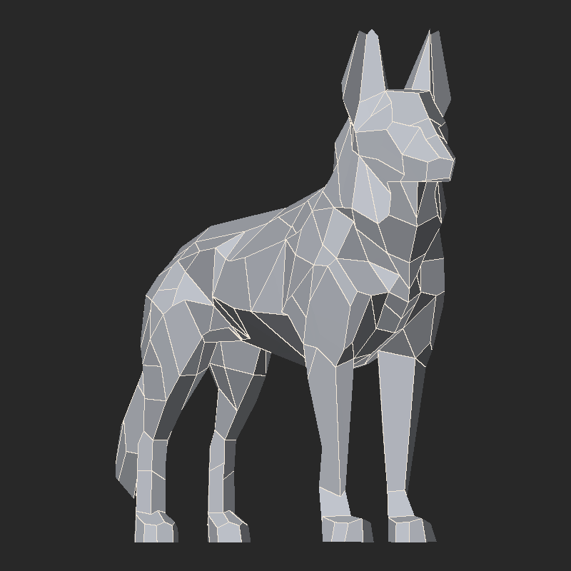

# Овчарка 6 — оригинал — отчёт сборки

Собрано `node shepherd-v6j3w/tools/make-shepherd.js shepherd6r` (тикет #170) из `from-dev/art/tools/plates/out/plates_s6r.json` — плиты конвейера `plates.js round=1 ang=4 mm=3 seed=2e-4 mina=1.5e-4 clean=0 tag=_s6r` по модели Meshy 7.1 `Meshy_AI_welded_adult_shepherd_final_20261122` (158 336 треугольников, гранёная, швы на текстуре), как вышли из конвейера — без чистки, высота 1000 мм, морда на +Z, симметричная; 457 плит, замкнутая, без постамента. Упрощения нет. Файл пересоздаётся при каждом запуске.

## Цифры

Как на сайте по умолчанию: сталь 2 мм, лазер, шов 0,5 мм, «Гнуть» и прорези включены. «Швы» — сварка без стыков, которые гнутся; «Проварка сгибов» — отдельно.

| | Овчарка 6 — оригинал |
|---|---|
| Плит конвейера (вход) | 457 |
| Граней на входе → после чистки | 457 → 457 |
| Деталей до → после чистки | 403 → 404 (−-0,2 %) |
| Деталей → позиций на резку | 404 → 160 (заготовок со сгибами 123) |
| Деталей на голове (центр детали в области картинок головы: глубже 330 мм от кончика морды, выше 560 мм) | 95 |
| Масса, сталь 2 мм | 22,5 кг |
| Швы (сварка) | 37,7 м |
| Проварка сгибов | 16,6 м (244 сгиба) |
| Самая узкая деталь | 25 мм |
| Габарит Ш × В × Г | 289 × 1000 × 1157 мм |
| Неплоскость граней, макс. | 0,035 мм |
| Самопересечения / протыкания | 0 / 0 |
| Нарушенные правила после чистки | рёбра короче 5 мм: 4, ступеньки (точки ближе 8 мм без ребра): 2, углы меньше 5°: 2 |
| Лишних швов (излом < 5°) | 69 |
| Сгиб без прорезей (предупреждение в «Итого», расчёт скрипта) | Г4 V165 (1), Г44 V136 (1), Г44.1 V136 (1) |

Проверка — по записанному `js/plates-shepherd6r.js` (после округления до 0,01 мм). Правила и пороги — `tools/check.js`: плоскость ≤ 0,1 мм, рёбра ≥ 5 мм, ступеньки ≥ 8 мм, углы ≥ 5°, узкие ≥ 15 мм, самопересечений и протыканий 0, симметрия ≤ 0,1 мм, грани наружу, вырожденных 0, похожесть ≤ 2 мм от эталона после склейки, открытых рёбер 0.

## Голова

Швы — с исходной текстуры модели Meshy (`src/shepherd5/model/*.png`), без прорезей глаз.

  

## Форма

- Морда: самая передняя точка (0, 742, 1157), на высоте 742 из 1000. Самая высокая точка (кончик уха): (69, 1000, 975).

## Чистка

Чистки этого скрипта нет (грани не нарезаем, форму не правим): плиты конвейера как есть — перевод в кадр фигуры (1000 мм, низ y = 0, зад z = 0) и грани наружу.

Принято правок: 0, отклонено (откат или нельзя): 0. Правка, после которой появилось новое нарушение из жёстких (самопересечение, протыкание, уход от эталона, открытое ребро, развёрнутая или вырожденная грань, несимметрия), откатывается.

Принято:

Осталось после чистки (не убирается без жёсткого нарушения):

- рёбра короче 5 мм: 4 — [[345,481],[348,482],[615,630],[616,631]]
- ступеньки (точки ближе 8 мм без ребра): 2 — [[511,580],[512,583]]
- углы меньше 5°: 2 — [169,170]

Лишние швы (излом < 5°; не сливаем, отдельной задачей): №144–№146 (0,8°, гнётся), №84–№83 (0,9°, гнётся), №171.1–№177.1 (1,4°, гнётся), №171–№177 (1,4°, гнётся), №25.1–№33.1 (1,6°, гнётся), №25–№33 (1,6°, гнётся), №79.1–№80.1 (1,6°, гнётся), №79–№80 (1,6°, гнётся), №42.1–№42 (2,0°, гнётся), №33.1–№46.1 (2,0°, гнётся), №33–№46 (2,0°, гнётся), №123–№121 (2,1°, гнётся), №123.1–№121.1 (2,1°, гнётся), №112.1–№126.1 (2,2°, гнётся), №112–№126 (2,2°, гнётся), №94.1–№93.1 (2,2°, гнётся), №94–№93 (2,2°, гнётся), №50.1–№59.1 (2,2°, гнётся), №50–№59 (2,2°, гнётся), №120.1–№138.1 (2,2°, гнётся), №120–№138 (2,2°, гнётся), №94.1–№78.1 (2,3°), №94–№78 (2,3°), №88.1–№77.1 (2,3°, гнётся), №88–№77 (2,3°, гнётся), №55.1–№61.1 (2,4°, гнётся), №55–№61 (2,4°, гнётся), №108.1–№105.1 (2,5°), №108–№105 (2,5°), №93.1–№78.1 (2,5°), №93–№78 (2,5°), №43–№32 (2,5°, гнётся), №43.1–№32.1 (2,5°, гнётся), №47.1–№56.1 (2,6°, гнётся), №47–№56 (2,6°, гнётся), №100.1–№98.1 (3,0°), №100–№98 (3,0°), №70–№85 (3,4°, гнётся), №84–№85.1 (3,6°, гнётся), №177.1–№176.1 (3,6°, гнётся), №177–№176 (3,6°, гнётся), №187.1–№196.1 (4,0°, гнётся), №187–№196 (4,0°, гнётся), №140.1–№159.1 (4,0°, гнётся), №140–№159 (4,0°, гнётся), №19.1–№25.1 (4,1°), №19–№25 (4,1°), №105.1–№91.1 (4,1°, гнётся), №105–№91 (4,1°, гнётся), №149.1–№137.1 (4,2°), №149–№137 (4,2°), №201–№194 (4,4°, гнётся), №201.1–№194.1 (4,4°, гнётся), №22–№28 (4,5°, гнётся), №22.1–№28.1 (4,5°, гнётся), №58.1–№49.1 (4,6°), №58–№49 (4,6°), №200.1–№192.1 (4,6°, гнётся), №200–№192 (4,6°, гнётся), №31–№24 (4,6°, гнётся), №31.1–№24.1 (4,6°, гнётся), №86.1–№100.1 (4,7°, гнётся), №86–№100 (4,7°, гнётся), №75.1–№74.1 (4,7°, гнётся), №75–№74 (4,7°, гнётся), №49–№37 (4,8°, гнётся), №49.1–№37.1 (4,8°, гнётся), №186–№188 (5,0°, гнётся), №186.1–№188.1 (5,0°, гнётся).

Все попытки чистки

## Картинки

  

