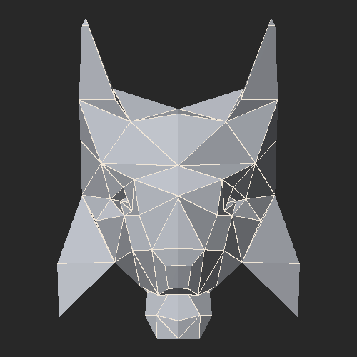
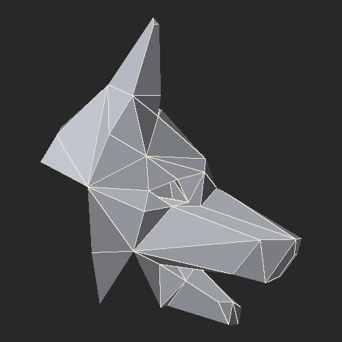
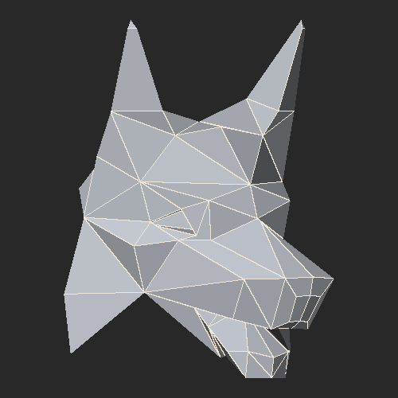
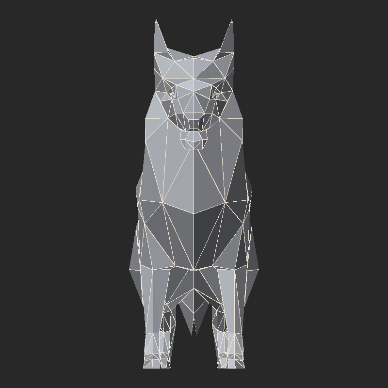
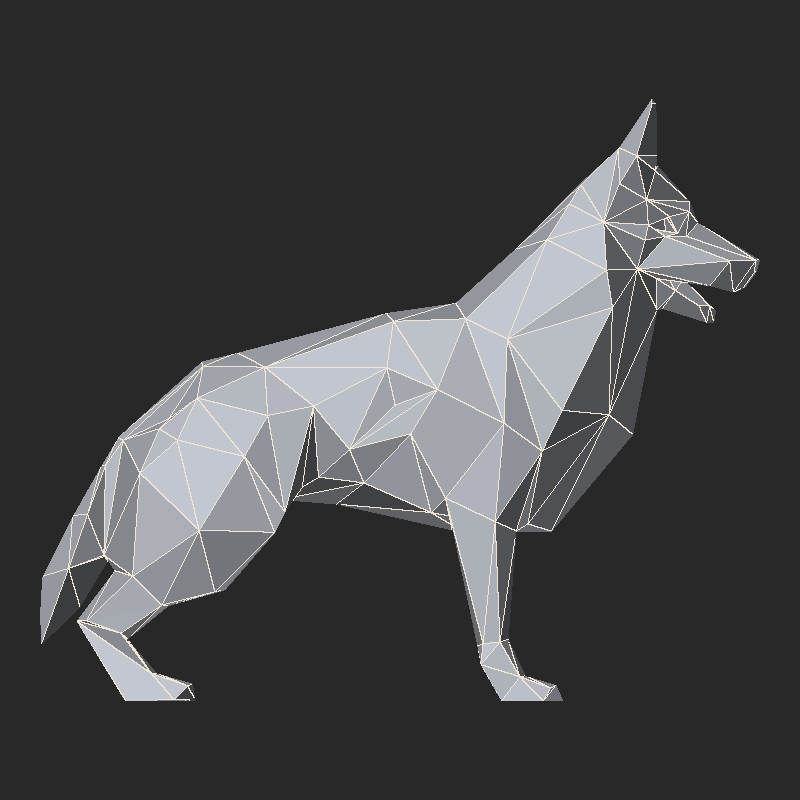
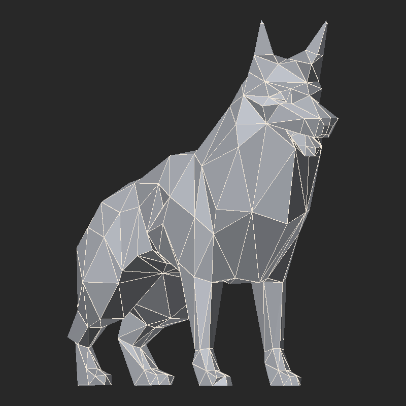

# Овчарка — отчёт сборки

Собрано `node shepherd-v6j3w/tools/make-shepherd.js` (тикет #141) из `from-dev/art/tools/plates/src/shepherd/shepherd_sym1000.obj` — модель Meshy `shepherd544_purple.obj` (Smart Topology, 544 грани), повёрнутая (Y вверх, морда на +Z), высота 1000 мм, правая половина отзеркалена; 632 треугольников, замкнутая, без постамента. Упрощения нет. Файл пересоздаётся при каждом запуске.

## Цифры

Как на сайте по умолчанию: сталь 2 мм, лазер, шов 0,5 мм, «Гнуть» и прорези включены. «Швы» — сварка без стыков, которые гнутся; «Проварка сгибов» — отдельно.

| | Овчарка |
|---|---|
| Треугольников в эталоне | 632 |
| Граней после склейки почти плоских (0,5° / 0,3 мм) → после чистки | 546 → 520 |
| Деталей до → после чистки | 525 → 502 (−4,4 %) |
| Деталей → позиций на резку | 502 → 311 (заготовок со сгибами 181) |
| Масса, сталь 2 мм | 26,1 кг |
| Швы (сварка) | 49,1 м |
| Проварка сгибов | 20,2 м (191 сгиб) |
| Самая узкая деталь | 7 мм |
| Габарит Ш × В × Г | 372 × 1000 × 1195 мм |
| Неплоскость граней, макс. | 0,005 мм |
| Самопересечения / протыкания | 0 / 0 |
| Нарушенные правила после чистки | узкие грани (деталь уже 15 мм): 10 |
| Лишних швов (излом < 5°) | 63 |
| Сгиб без прорезей (предупреждение в «Итого», расчёт скрипта) | Г19.1 m157 (1), Г67 V178 (1), Г72 V177 (1), Г72.1 V177 (1), Г80.1 V166 (1), Г87 V172 (1), Г87.1 V172 (1), Г93 V170 (1), Г93.1 V170 (1), Г96 V169 (1), Г96.1 V169 (1) |

Проверка — по записанному `js/plates-shepherd.js` (после округления до 0,01 мм). Правила и пороги — `tools/check.js`: плоскость ≤ 0,1 мм, рёбра ≥ 5 мм, ступеньки ≥ 8 мм, углы ≥ 5°, узкие ≥ 15 мм, самопересечений и протыканий 0, симметрия ≤ 0,1 мм, грани наружу, вырожденных 0, похожесть ≤ 2 мм от эталона после склейки, открытых рёбер 0.

## Почему деталей ~500, а не ~400

Оценка «~396 деталей» считалась при угле 8° (соседние треугольники с изломом до 8° — одна деталь). Сайт делит на детали при 1,5° (`buildParts(…, 1.5, 1.5)`), а склейка берёт только почти плоские грани (0,5° / 0,3 мм), чтобы не искажать форму. Грани с изломом 1,5–8° остаются отдельными деталями; слить их — значит выровнять в плоскость, это отдельная задача.

## Нос

Квадратный нос эталона (лобовая грань ~44 × 48 мм) переделан «шапочкой», как у сварной овчарки на фото Виталия (21.11): кольцо шире, внутри пластина, выдвинутая вперёд, между ними скосы по кругу. Сбоку кончик носа тупой и закруглённый, спереди нос шире. Параметры — `NOSE` в скрипте; `loadRef({nose:false})` — эталон без правки.

- нос: кольцо 44 → 61 мм шириной, пластина ×0.5 выдвинута на 8 мм, скосы по кругу (6 лобовых треугольников → 6 скосов + пластина)

  

## Форма

- Морда: самая передняя точка (0, 733, 1196), на высоте 733 из 1000. Самая высокая точка (кончик уха): (107, 1000, 1017).
- Глаз — щель под надбровьем в сетке эталона, чистка его не трогала (см. картинки). Глаз отдельной деталью — отдельный тикет.

## Чистка

Принято правок: 13, отклонено (откат или нельзя): 41. Правка, после которой появилось новое нарушение из жёстких (самопересечение, протыкание, уход от эталона, открытое ребро, развёрнутая или вырожденная грань, несимметрия), откатывается.

Принято:

- короткие рёбра — слито 32
- ступенька 0.7 мм у 0,334,403 — да
- игла 4.0° у 19,887,967 — да
- игла 4.8° у 0,190,4 — да
- игла 4.5° у 59,941,992 — да
- игла 4.2° у 83,968,1001 — да
- узкая грань у 110,962,1011 + соседняя (излом 3.5°) — да
- узкая грань у 33,664,1088 + соседняя (излом 9.7°) — да
- узкая грань у 70,794,1017 + соседняя (излом 1.8°) — да
- узкая грань у 15,785,1089 + соседняя (излом 7.6°) — да
- узкая грань у 96,970,1001 + соседняя (излом 1.5°) — да
- узкая грань у 98,970,999 + соседняя (излом 6.1°) — да
- масштаб на высоту 1000 мм (×0.99990, только по высоте, сдвиг до 0.10 мм) — да

Осталось после чистки (не убирается без жёсткого нарушения):

- узкие грани (деталь уже 15 мм): 10 — [442,443,482,483,496,497,502,503,506,507]

Лишние швы (излом < 5°; не сливаем, отдельной задачей): №239.1–№245.1 (1,3°, гнётся), №239–№245 (1,3°, гнётся), №171.1–№155.1 (1,5°, гнётся), №171–№155 (1,5°, гнётся), №119.1–№105.1 (1,7°, гнётся), №119–№105 (1,7°, гнётся), №14.1–№19.1 (1,7°, гнётся), №14–№19 (1,7°, гнётся), №159.1–№158.1 (1,8°), №159–№158 (1,8°), №142.1–№141.1 (1,8°, гнётся), №142–№141 (1,8°, гнётся), №210.1–№219.1 (2,0°, гнётся), №210–№219 (2,0°, гнётся), №177.1–№188.1 (2,0°), №177–№188 (2,0°), №98.1–№112.1 (2,1°, гнётся), №98–№112 (2,1°, гнётся), №163.1–№148.1 (2,3°, гнётся), №163–№148 (2,3°, гнётся), №98.1–№85.1 (2,3°), №98–№85 (2,3°), №56.1–№65.1 (2,7°, гнётся), №56–№65 (2,7°, гнётся), №96.1–№109.1 (2,7°, гнётся), №96–№109 (2,7°, гнётся), №208–№201 (2,8°, гнётся), №208.1–№201.1 (2,8°, гнётся), №174.1–№162.1 (2,9°, гнётся), №174–№162 (2,9°, гнётся), №80.1–№80 (3,1°), №41.1–№32.1 (3,5°), №41–№32 (3,5°), №19.1–№23.1 (3,5°), №19–№23 (3,5°), №251.1–№250.1 (3,6°, гнётся), №251–№250 (3,6°, гнётся), №137.1–№153.1 (3,6°, гнётся), №137–№153 (3,6°, гнётся), №176.1–№187.1 (3,8°, гнётся), №176–№187 (3,8°, гнётся), №33.1–№42.1 (3,8°), №33–№42 (3,8°), №157.1–№160.1 (3,9°, гнётся), №157–№160 (3,9°, гнётся), №164.1–№161.1 (3,9°, гнётся), №164–№161 (3,9°, гнётся), №23.1–№26.1 (3,9°, гнётся), №23–№26 (3,9°, гнётся), №80.1–№94.1 (4,0°, гнётся), №80–№94 (4,0°, гнётся), №14.1–№9.1 (4,2°), №14–№9 (4,2°), №28.1–№22.1 (4,2°, гнётся), №28–№22 (4,2°, гнётся), №180.1–№167.1 (4,2°), №180–№167 (4,2°), №165.1–№150.1 (4,2°), №165–№150 (4,2°), №68.1–№81.1 (4,2°), №68–№81 (4,2°), №201–№191 (4,4°), №201.1–№191.1 (4,4°).

## Известные расхождения (smoke: ПРЕДУПР)

Движок страницы — копия коня (и собаки). На овчарке вылезли крайние случаи, которых у коня нет; чинить в общем движке отдельными тикетами. В `tools/smoke.js` эти проверки печатаются как ПРЕДУПР и не валят прогон (список `KNOWN`; глушится проверка целиком — новая поломка в ней тоже уйдёт в ПРЕДУПР). Цифры раздела — снимок прогона smoke 21.11 (тикет #141), скрипт их не пересчитывает: после пересборки сверить с выводом `node shepherd-v6j3w/tools/smoke.js`.

- **Острый шов 17° у уха** — на уголок-шаблон 17° (в допуске: `TPL_MIN` = 15°) не влезает гравировка «У17°»; на двух сгибах уголок в 3D-картинке встаёт не с той стороны / не под тем углом.
- **Мелкие детали кончика уха и лап (8–12 мм в узком месте, 5 зеркальных пар)** — узкие грани, чистка их не убрала без ухода от эталона. На них не влезают 9 подписей сгибов и 2 номера детали; у карты №1 нет места под длины сторон; одна подпись шага сборки у края снимка.
- **Окно «крутить сгиб»** — у одного сгиба (Г17 и зеркальный) в шапке угол ~41° и V/m не совпадают с заготовкой (139°).
- **Зеркальные пары в DXF** — у одной пары (Г80 / Г80.1) подписи сгибов разные.
- **Гибка при 1,5 мм / шов 1 мм** — без повтора с запретом сгибов 2 заготовки выходят битыми (страница и сборка повторяют — у них всё целое).

Все попытки чистки

- короткие рёбра — слито 32
- ступенька 0.7 мм у 0,334,403 — да
- игла 4.0° у 19,887,967 — да
- игла 4.8° у 0,190,4 — да
- игла 4.5° у 59,941,992 — да
- игла 4.2° у 83,968,1001 — да
- узкая грань у 27,235,93 + соседняя (излом 43.5°) — откат: far
- узкая грань у 27,235,93 + соседняя (излом 61.3°) — нет: узкая плита
- узкая грань у 27,235,93 + соседняя (излом 69.7°) — откат: far
- узкая грань у -27,235,93 + соседняя (излом 43.5°) — откат: far
- узкая грань у -27,235,93 + соседняя (излом 61.3°) — нет: узкая плита
- узкая грань у -27,235,93 + соседняя (излом 69.7°) — откат: far
- узкая грань у 110,962,1011 + соседняя (излом 3.5°) — да
- узкая грань у 33,664,1088 + соседняя (излом 9.7°) — да
- узкая грань у 70,794,1017 + соседняя (излом 1.8°) — да
- узкая грань у 61,778,1030 + соседняя (излом 41.7°) — откат: far
- узкая грань у 61,778,1030 + соседняя (излом 57.7°) — откат: far
- узкая грань у 61,778,1030 + соседняя (излом 90.6°) — откат: pierce
- узкая грань у -61,778,1030 + соседняя (излом 41.7°) — откат: far
- узкая грань у -61,778,1030 + соседняя (излом 57.7°) — откат: far
- узкая грань у -61,778,1030 + соседняя (излом 90.6°) — откат: pierce
- узкая грань у 135,16,848 + соседняя (излом 54.4°) — откат: far
- узкая грань у 135,16,848 + соседняя (излом 77.4°) — откат: far
- узкая грань у 135,16,848 + соседняя (излом 93.6°) — откат: far
- узкая грань у -135,16,848 + соседняя (излом 54.4°) — откат: far
- узкая грань у -135,16,848 + соседняя (излом 77.4°) — откат: far
- узкая грань у -135,16,848 + соседняя (излом 93.6°) — откат: far
- узкая грань у 15,785,1089 + соседняя (излом 7.6°) — да
- узкая грань у 12,660,1039 + соседняя (излом 41.4°) — откат: far
- узкая грань у 12,660,1039 + соседняя (излом 43.3°) — откат: far
- узкая грань у 12,660,1039 + соседняя (излом 65.3°) — откат: far
- узкая грань у -12,660,1039 + соседняя (излом 41.4°) — откат: far
- узкая грань у -12,660,1039 + соседняя (излом 43.3°) — откат: far
- узкая грань у 108,994,1019 + соседняя (излом 33.4°) — откат: far
- узкая грань у 108,994,1019 + соседняя (излом 96.8°) — откат: far
- узкая грань у 108,994,1019 + соседняя (излом 112.9°) — откат: far
- узкая грань у -108,994,1019 + соседняя (излом 33.4°) — откат: far
- узкая грань у -108,994,1019 + соседняя (излом 96.8°) — откат: far
- узкая грань у -108,994,1019 + соседняя (излом 112.9°) — откат: far
- узкая грань у 96,970,1001 + соседняя (излом 1.5°) — да
- узкая грань у 108,994,1019 + соседняя (излом 32.9°) — откат: far
- узкая грань у 108,994,1019 + соседняя (излом 96.8°) — нет: самопересечение
- узкая грань у 108,994,1019 + соседняя (излом 113.6°) — откат: far
- узкая грань у -108,994,1019 + соседняя (излом 32.9°) — откат: far
- узкая грань у -108,994,1019 + соседняя (излом 96.8°) — нет: самопересечение
- узкая грань у -108,994,1019 + соседняя (излом 113.6°) — откат: far
- узкая грань у 98,970,999 + соседняя (излом 6.1°) — да
- узкая грань у 108,994,1019 + соседняя (излом 33.6°) — откат: far
- узкая грань у 108,994,1019 + соседняя (излом 94.2°) — откат: far
- узкая грань у 108,994,1019 + соседняя (излом 113.3°) — откат: far
- узкая грань у -108,994,1019 + соседняя (излом 33.6°) — откат: far
- узкая грань у -108,994,1019 + соседняя (излом 94.2°) — откат: far
- узкая грань у -108,994,1019 + соседняя (излом 113.3°) — откат: far
- масштаб на высоту 1000 мм (×0.99990, только по высоте, сдвиг до 0.10 мм) — да

## Картинки

  

